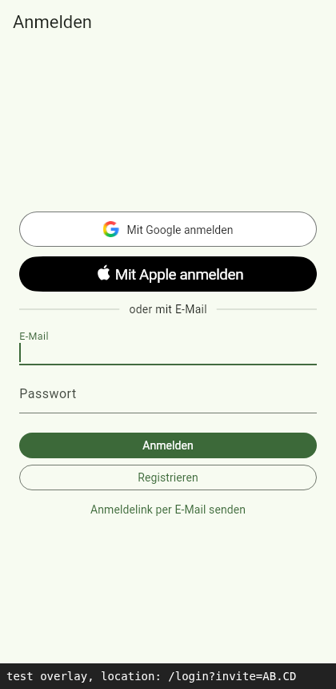

# Job 7b: loose ends of the Vercel hosting

PR: https://github.com/trost-systems/family-groceries/pull/18

## What changed for Peter and Lea

- Links whose last part contains a dot, such as `/join/AB.CD`, now open
  the web app. Before, Vercel answered them with a 404.
- `docs/NEEDS_PETER.md` lists only what Peter still has to do, each with
  its state on 2026-10-24. The GitHub Pages, github.io Site URL and
  database password steps are gone. No remaining step changes the hosted
  Site URL or removes a redirect URL.

## What was built, where

| Item | Change |
| --- | --- |
| 1. NEEDS_PETER | New status section. Sections 1, 2 and 5 keep only the current state. Section 3 and "Job 4: web hosting" are deleted. Google step 5 says no JavaScript origin is needed. Step 14 is marked done. |
| 2. Stale wording | README, `.env.example` and `docs/REUSED_FROM_EMOTELY.md` describe the API-only deploy that fails red. The root `DONE_SUMMARY.md` job 1 line no longer says the deploy "skips cleanly". |
| 3. SPA rewrite | `vercel.json` rewrites every path to `index.html` except Flutter's asset folders (`assets/`, `canvaskit/`, `icons/`) and asset extensions. The no-cache header uses the same pattern. `e2e/web-smoke.mjs` checks `/join/AB.CD` and `/lists/a.b` (index.html) and `/missing.js`, `/assets/x.png` and `/canvaskit/missing.wasm` (404). |
| 4. APP_URL | `Environment.appUrl` reads only the `APP_URL` define. The value lives in `app/config/auth.json`, which `scripts/vercel.sh` and both fastlane lanes pass. `app/test/app/auth_config_test.dart` checks that `APP_URL` is an https origin, that a build without the define has no app URL, and that every production build command passes the file. |
| Docs | `docs/DECISIONS.md` 7b.1 to 7b.3, `docs/AUTH.md` and `docs/RELEASE.md` (APP_URL), the verify map `features/web-hosting.md`. |

Changed outside the repo: the unused repo secret `SUPABASE_DB_PASSWORD` was
deleted (DECISIONS 7b.3). The value is still in `~/groceries-ops/env`.

## How to verify

```bash
(cd e2e && npm ci) && node e2e/web-smoke.mjs https://family-groceries-pied.vercel.app /tmp/smoke
(cd app && flutter test test/app/auth_config_test.dart)
rg -n "DB_PASSWORD|github.io|skips cleanly|WEB_BASE_PATH"
```

The `rg` hits left are intentional: `docs/SPEC.md` (the ops spec, copied
verbatim), past job records in `docs/done/`, and DECISIONS entries that
record the removal (7.x, 7b.3).

## Results

- The new rewrite pattern, compiled with Vercel's `@vercel/routing-utils`,
  matched all 16 test paths. The old pattern got `/join/AB.CD`,
  `/lists/a.b` and `/canvaskit/x` wrong.
- `web-smoke.mjs` on production before the merge failed with
  `FAIL /join/AB.CD serves index.html (404)`.
- `web-smoke.mjs` on the branch preview (share link from the Engineering
  Lead): every check `ok`, on the first head and on the rebased head. On the
  rebased head, two runs timed out waiting for `appleid.apple.com` to load,
  and the third run passed every check. The Apple redirect is outside this
  change.
- In a browser, `/join/AB.CD` on the preview ends at `/login?invite=AB.CD`
  (screenshot below; the bottom bar is a test overlay that prints
  `location`).
- `flutter test` 208/208, `flutter analyze` clean, deploy tooling tests
  13/13. With `--dart-define-from-file=config/auth.json` removed from a
  Fastfile lane, or from `scripts/vercel.sh`, the new test fails.
- CI on the PR: every job green, `ci-ok` included.
- Production after the merge (edbc6ab, 2026-10-24 18:30): Vercel deploy
  succeeded and `node e2e/web-smoke.mjs https://family-groceries-pied.vercel.app`
  passed every check, `/join/AB.CD`, `/lists/a.b` and the four 404 cases
  included. CI on main is green. "Supabase deploy" did not run, because
  it only runs for changes under `supabase/` and this PR has none.

No local Supabase stack was started, so nothing needed `supabase stop`.



## Still open

Nothing from this job. Peter's open items are in the status section of
`docs/NEEDS_PETER.md`.
