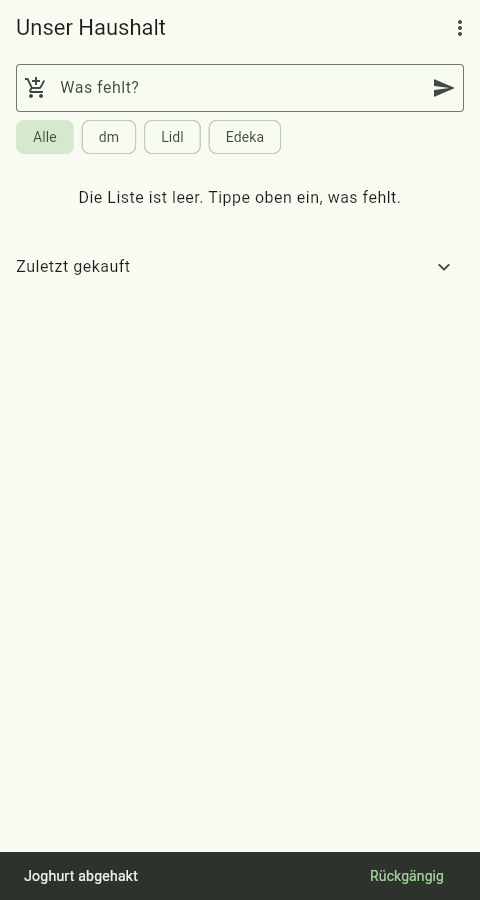

# Job 11b: job 11's loose ends

PR: https://github.com/trost-systems/family-groceries/pull/39

Job 11's review 1 left four items open. All four are fixed, each with a test
or a check anyone can rerun.

## 1. The model trailer comes from `MODEL_CO_AUTHOR`

`scripts/lib.sh` no longer hard-codes `Co-Authored-By: Claude Opus 5.5`.
`MODEL_CO_AUTHOR="Name <email>"` adds `Co-authored-by: Name <email>`. When
it is unset, nothing is added. An agent's own commits carry its co-author
line anyway, and that line is kept. A value that is not `Name <email>`
stops `push-pr.sh` before it pushes anything. Peter's trailer is always
last. See DECISIONS 11b.2.

## 2. The landed body is the PR description

`squash_commit` takes the body from `gh pr view --json body` and strips
GitHub's CRLF line ends. Working commit messages such as `done: PR number`
no longer land. `Co-authored-by` lines from the description and from the
branch's commits move into the trailer block, once each, matched without
regard to case.

The description has to be current when the PR lands, so two guards keep it
that way:

- `push-pr.sh` squashes again when the description changed, even if the
  code did not.
- `merge-pr.sh` refuses (exit 1) a head whose message is not the current
  description, and says to rerun `push-pr.sh`. Review 0 asked for this.

See DECISIONS 11b.1.

## 3. `MERGE_WAIT_MINUTES` takes whole minutes

`merge-pr.sh` checks the value before it calls `gh`. `0.5`, `abc`, `-1` and
`1 2` each exit 2 with "MERGE_WAIT_MINUTES must be a whole number of
minutes (like 30), not '…'". `08` means 8 (`10#`, not octal). docs/CI.md
documents the rule.

### Test for items 1 to 3

`scripts/landing-test.sh` runs in the lint gate. It runs `push-pr.sh` and
`merge-pr.sh` against a scratch bare remote and a fake `gh`. The same test,
run against older copies of the scripts:

| Scripts | Result |
| --- | --- |
| main's `push-pr.sh` and `merge-pr.sh` (36e4274) | 17 failures. Examples: the WIP commit messages landed, `MERGE_WAIT_MINUTES=0.5` gave "syntax error: invalid arithmetic operator", `MODEL_CO_AUTHOR=Claude` was accepted |
| this branch before the description guards | Fails "push-pr.sh after a description edit lands the new description", then "merge-pr.sh refuses a head whose body is not the current description" ("merged a stale description") |
| this branch | "push-pr.sh and merge-pr.sh: all cases pass" (about 2 s) |

The real PR also went through it: `scripts/push-pr.sh` on #39 squashed into
a commit whose body was #39's description, ending in the Claude line from
the branch's commits and then Peter's trailer.

## 4. The `list.spec.ts:22` flake

### Root cause

`await expect(page.getByText('Joghurt abgehakt').first()).toBeVisible()`
never matched the snackbar. The trace of a cold run (`--trace=on`, DOM
snapshots) shows two copies of the text:

- The snackbar itself:
  `FLT-SEMANTICS role="group" aria-label="Joghurt abgehakt"`, with the
  "Rückgängig" button inside. A snackbar with an action keeps its text in
  `aria-label`, and `getByText` does not match `aria-label`.
- Flutter's screen-reader announcement:
  `FLT-ANNOUNCEMENT-POLITE aria-live="polite"`, a 1×1 px element moved off
  screen with the text as content. Playwright counts it as visible. The
  engine clears it after a few hundred milliseconds.

So the assertion passed only when Playwright polled inside the
announcement's short window. A probe that polled every 50 ms after the tick
saw the text:

| CPU throttle (CDP `Emulation.setCPUThrottlingRate`) | `getByText('Joghurt abgehakt')` count > 0 |
| --- | --- |
| x1 | from +130 ms to +402 ms after the click, then 0 while the snackbar still showed |
| x4 | from +412 ms to +510 ms |
| x8 | never |

A loaded box (review 1's failure was at 09:17, when mem-guard logged
headroom under 3 GB and psi full 13.27) works like the throttled rows.
Snackbars without an action render their text in a `SPAN`, which
`getByText` matches for as long as they show. The other snackbar checks
(`steht schon auf der Liste`, sign-in errors) are of that kind.

### Fix

`actionSnackBar(page, text)` in `e2e/tests/helpers.ts` is
`getByRole('group', { name: text, exact: true })`. `list.spec.ts:28` uses
it. No retries and no timeout changes. AGENTS.md ("Flutter web e2e") tells
the next spec to use it.

### Evidence

- **Old locator fails, new one passes, same throttle.** Four probe tests
  ticked Joghurt and asserted the snackbar within 3 s:
  - x8 with `getByText`: failed.
  - x8 with `actionSnackBar`: passed (4.5 s).
  - x16 with `getByText`: failed.
  - x16 with `actionSnackBar`: passed (6.6 s).

  In the failure screenshot of the x8 `getByText` test, the snackbar is on
  screen:

  

  The probe was an untracked spec (`e2e/tests/zz-probe.spec.ts`, deleted
  afterwards). To rerun it, put this in `e2e/tests/` and run
  `scripts/verify.sh --only e2e -- tests/zz-probe.spec.ts`:

  ```ts
  import { expect, test } from './fixtures';
  import { actionSnackBar, addItem, itemRow, newEmail, signUpWithHousehold, tickBox } from './helpers';

  for (const rate of [8, 16]) {
    for (const locator of ['getByText', 'actionSnackBar'] as const) {
      test(`probe CPU x${rate} ${locator}`, async ({ page }) => {
        test.setTimeout(180_000);
        await signUpWithHousehold(page, newEmail('probe'));
        const cdp = await page.context().newCDPSession(page);
        await cdp.send('Emulation.setCPUThrottlingRate', { rate });
        await addItem(page, 'Joghurt');
        await expect(itemRow(page, 'Joghurt')).toBeVisible();
        await tickBox(page, 'Joghurt').click();
        await expect(itemRow(page, 'Joghurt')).toHaveCount(0);
        const snack = locator === 'getByText'
          ? page.getByText('Joghurt abgehakt').first()
          : actionSnackBar(page, 'Joghurt abgehakt');
        await expect(snack).toBeVisible({ timeout: 3_000 });
      });
    }
  }
  ```

- **The spec alone, 10 times.** These were 10 separate `playwright test
  tests/list.spec.ts` runs, each with a fresh browser, from 13:14 to 13:19.
  Each run covers the whole file (4 tests, line 22 included), so 40 of 40
  tests passed in 15.3 to 17.4 s per run. The longest mem-guard gap was
  164 s, in run 7, which is under the 5 min void threshold.

- **5 full local e2e runs.** These are full e2e gate runs (web build plus
  all 66 Playwright tests, `--workers=1`, port block 554xx). For each run
  I checked the longest gap between mem-guard samples (normally 60 s). A run with a gap of 5 min or more is void under
  the 06:34 board ruling.

  Counted runs are on the rebased head (3abb2ed plus this PR). Later
  commits changed only docs and the screenshot, and the main commits since
  then (#41, #42, #44) touch no app, e2e, migration or function files.

  | Run | Time (CET, 2026-10-25) | Result | Longest mem-guard gap | Verdict |
  | --- | --- | --- | --- | --- |
  | 1 | 13:21-13:47 | 66 passed | 755 s (13:23:13 to 13:35:48) | void, on the pre-rebase head |
  | 2 | 13:47-14:04 | 66 passed | 529 s (13:47:50 to 13:56:39, during the lock wait) | void, on the pre-rebase head |
  | 3 | 14:40-14:45 | 66 passed (4.4 min) | 61 s | green, but on the pre-rebase head, so not counted |
  | 4 | 14:47-15:42 | 64 passed, 2 failed (`mcp.spec.ts:183` page closed, `partner-news.spec.ts:6` `ERR_NETWORK_CHANGED`) | 2616 s (14:57:03 to 15:40:39) | void, on the pre-rebase head |
  | 5 | 15:52-16:42 | 65 passed, 1 failed (`mcp.spec.ts:248`, 11.8 min) | 2289 s (16:02:29 to 16:40:38) | void |
  | 6 | 16:56-17:01 | 66 passed (4.6 min) | 61 s | **green 1/5** |
  | 7 | 17:34-17:39 | 66 passed (4.8 min) | 61 s | **green 2/5** |
  | 8 | 17:39-17:44 | 66 passed (4.7 min) | 61 s | **green 3/5** |
  | 9 | 17:44-18:13 | 64 passed, 2 failed (`suggestions.spec.ts:59`, `voice.spec.ts:170`, 28.5 min) | 1489 s (17:48:36 to 18:13:25) | void |
  | 10 | 18:13-18:50 | stopped unfinished (the loop hit the shell's 2 h limit) | 1435 s (18:13:25 to 18:37:20) | void |
  | 11 | 18:51-18:56 | 66 passed (4.7 min) | 61 s | **green 4/5** |
  | 12 | 19:07-19:12 | 66 passed (4.6 min) | 60 s | **green 5/5** |

  No run failed outside a freeze. Every failure (runs 4, 5 and 9) fell
  inside a gap of 24 to 44 min, and the specs that failed are not the list
  spec. Runs 1 and 2 were timed from the start of the lock wait. From run 3
  on, each run was timed from taking the lock.

## Not done, and why

- `MODEL_CO_AUTHOR` writes `Co-authored-by:`, the spelling GitHub and
  Peter's trailer use, while agents' commits write `Co-Authored-By:`. The
  dedupe ignores case, so no trailer is doubled (review 0, nice to have 2).
  I left this as is.
- The ops-side docs (COORDINATION.md, COMMON.md) are the lead's. The
  watcher already updated them on 2026-10-25 at 09:37.
