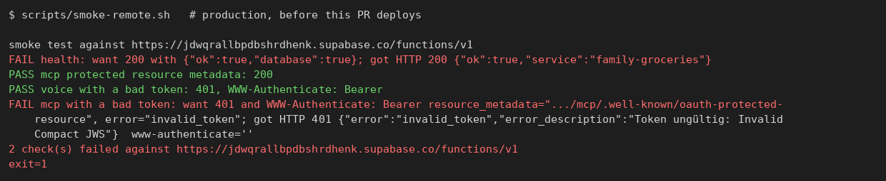
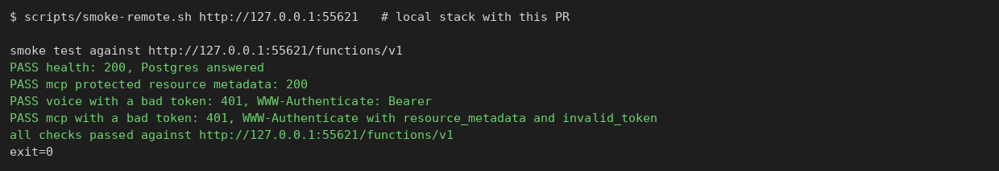
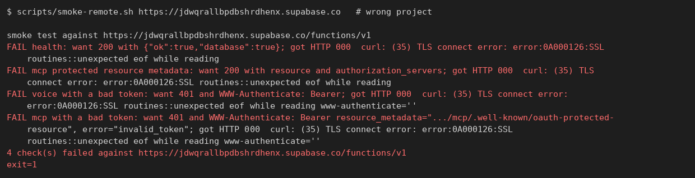
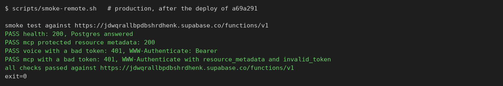

# Job 13: keepalive, deploy smoke test, function rollback (2026-10-24/25)

PR #30, on `main` as `a69a291`. The free Supabase project now gets one real
database read a day, every deploy is smoke-tested, and edge functions can be
rolled back to an earlier `main` commit with one dispatch. The new smoke test
found a production bug on its first run: MCP clients with an expired or bad
token got a 401 without `WWW-Authenticate`, so they couldn't find the metadata
they need to sign in again. That is fixed and live.

## What was built

- **`health` reads Postgres** (`supabase/functions/health/`,
  `_shared/db.ts` `databaseAnswers`): `select exists (select from
  public.classifier_terms)`, the shared seed dictionary, no user data, with a
  5 s deadline. 200 `{"ok":true,"database":true}`, otherwise 503
  `{"ok":false,"database":false}`.
- **`.github/workflows/keepalive.yml`**: daily at 05:23 UTC and on dispatch.
  One read through `health`; fails if the project or database doesn't answer;
  opens or comments on one "Keepalive failed" issue (naming the failed step),
  closed by the next green run. Re-enables its own schedule (best effort).
- **`keepalive-schedule` job in `ci.yml`**: every push to `main` re-enables
  the keepalive. GitHub never turns a schedule back on that it disabled after
  60 idle days; this and the manual command in `docs/DEPLOY.md` are the
  guarantee.
- **`scripts/smoke-remote.sh [url]`**: read-only, no credentials. health 200
  with `database:true`; MCP Protected Resource Metadata 200; `voice` and `mcp`
  with a made-up token answer 401 with the right `WWW-Authenticate`.
- **`supabase-deploy.yml`**: smoke test after every deploy (3 attempts, 15 s
  apart); deployed SHA in the job summary; deploys from `main` only; input
  `ref` redeploys only the edge functions of an earlier `main` commit and runs
  that commit's own smoke test. A ref that isn't a SHA, isn't on `main`, or
  predates the smoke script is refused before anything deploys.
- **MCP fix** (`supabase/functions/mcp/handler.ts`): the challenge's
  `error_description` is RFC 6750 ASCII (umlauts transliterated). The hosted
  gateway dropped the whole header over "ungültig".
- **e2e**: `live-sync.spec.ts` accepts the partner's "Neu" badge on the edited
  item (it clears only after 3 s on screen; the assertion could land earlier).
- **Docs**: `docs/DEPLOY.md` (runbook: deploy, smoke, rollback, fix-forward
  database, keepalive, resuming a paused project); DECISIONS 13.1–13.11 with
  sources; NEEDS_PETER "Job 13: database backups"; verify-skill feature
  `features/hosted-backend.md`.

## Research (DECISIONS 13.1–13.3, NEEDS_PETER)

- Supabase pauses free projects after 7 days of low database activity; a
  paused project restores for up to 1 year
  (https://supabase.com/docs/guides/platform/free-project-pausing).
- GitHub disables scheduled workflows in public repos after 60 days without
  repository activity
  (https://docs.github.com/en/actions/reference/workflows-and-actions/events-that-trigger-workflows).
- Job 06's nightly run isn't on `main` (status waiting), so it doesn't keep
  the project awake.
- Backups: the free plan has none. A GitHub runner can't reach the IPv6-only
  direct host but reaches the session pooler
  `aws-1-eu-central-1.pooler.supabase.com:5432` (log:
  `docs/screenshots/13/runner-pooler-probe.txt`); Postgres 17. The proposal
  (weekly `pg_dump --data-only` of `public`, encrypted with age to Peter's
  public key, 90-day artifact) waits for Peter's decision and key pair. No key
  was created and nothing unencrypted was implemented.

## Acceptance runs (after the merge)

| Check | Result |
| --- | --- |
| Supabase deploy of `a69a291` (push) | [run 40190121082](https://github.com/trost-systems/family-groceries/actions/runs/40190121082): Migrations, Edge functions, Smoke test all green |
| Keepalive, `workflow_dispatch` | [run 40190402481](https://github.com/trost-systems/family-groceries/actions/runs/40190402481): "Postgres answered", schedule enabled, workflow state `active` |
| Rollback, `-f ref=a69a291` | [run 40190428524](https://github.com/trost-systems/family-groceries/actions/runs/40190428524): notice "Rollback: redeploying the edge functions of a69a291…", Migrations skipped, Smoke test green |
| CI on `main` (push) | [run 40190121041](https://github.com/trost-systems/family-groceries/actions/runs/40190121041): `keepalive-schedule` and `ci-ok` green |
| `scripts/smoke-remote.sh` from the box, production | 4 PASS, exit 0 (screenshot 4) |
| `scripts/smoke-remote.sh https://jdwqrallbpdbshrdhenx.supabase.co` | 4 FAIL, exit 1 (screenshot 3) |
| `actionlint`, `scripts/check-gates.sh` | clean |

Production before the deploy (the two checks this job fixed fail), the local
stack with the fix, a wrong URL, production after the deploy:

## Tests

- Deno: 249 passed (health: 503 on a failed read and on a 5 s timeout; MCP:
  the challenge stays RFC 6750 ASCII for a German message).
- Local stack (556xx): smoke 4/4 PASS; database container stopped → health
  503 after 5 s, 200 again after restart.
- Rollback guards: the step's own `run:` block in a scratch clone rejects
  `main`, `-x`, a commit not on main and `feea57a` (predates the smoke
  script), and checks out a main commit that has it.
- Issue reporting: the steps' scripts against this repo with a test title
  (#28, #29, both closed): create, then comment, then close; `--search` lag
  caught and replaced by an exact-title match on the plain list.
- 5 counted green runs on the rebased head before landing: one full
  `scripts/verify.sh` (every gate, Playwright 66/66), then four e2e gate runs
  (66/66 each). Void under the 06:34 freeze ruling: two runs overlapping VM
  freezes 11:22:50–11:42:08 and 11:49:28–12:08:32 (mem-guard gaps). Reset:
  one attempt with failures during a 282 s stall (09:43:35–09:48:17), and
  earlier attempts on the pre-rebase head (a 117 s local PostgREST stall, the
  "Neu" badge race, now fixed). Live-sync and MCP OAuth specs 15× each on a
  quiet box: 30/30.

## Missing or blocked

- Backups: a decision for Peter (NEEDS_PETER, "Job 13: database backups"):
  the age key pair and a `backup` environment secret.
- Whether the keepalive's self-enable restarts GitHub's 60-day clock is
  undocumented and untestable short of 60 quiet days. Pushes to `main` and the
  manual `gh workflow enable` cover it; Supabase also emails Peter before a
  pause.
- Peter should watch the repository's issues: a failed keepalive opens one.
