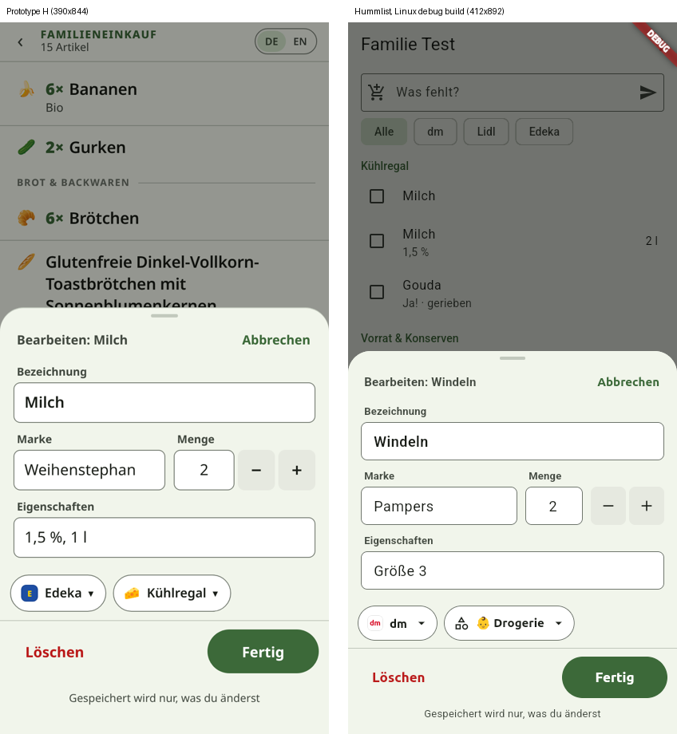
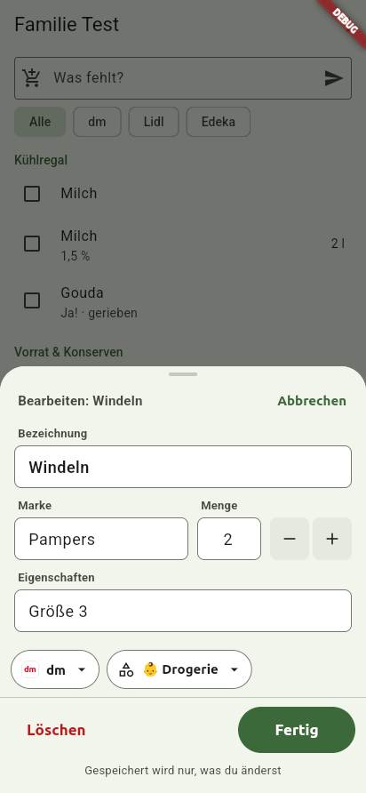
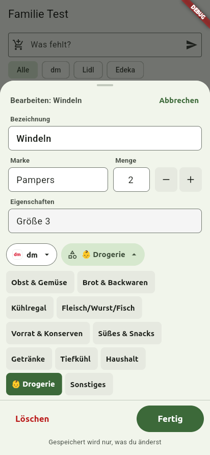
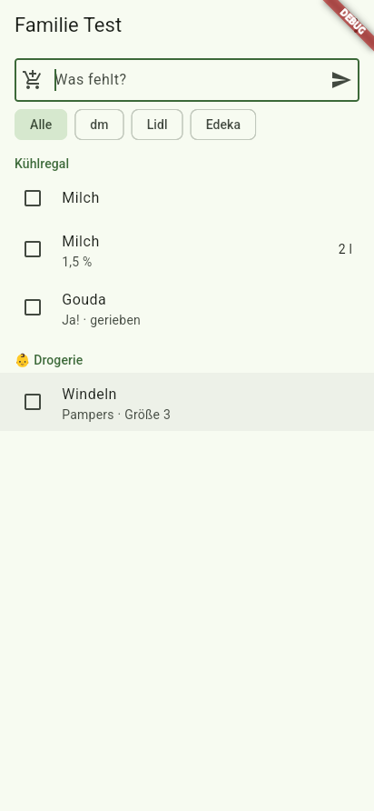
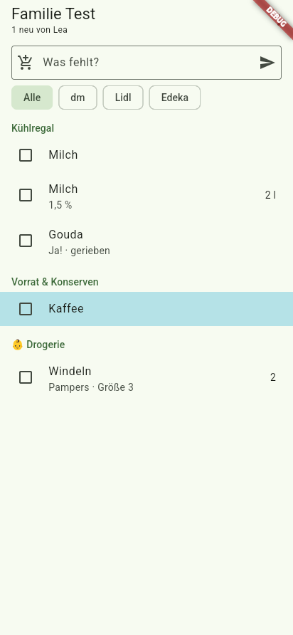
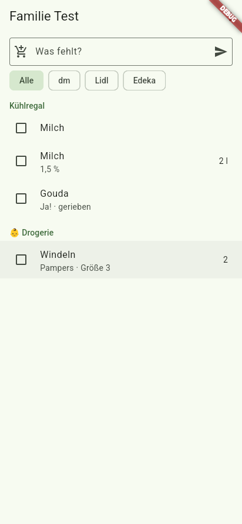

# Job 15: design H, part 1: data, parser and edit sheet

PR: https://github.com/trost-systems/family-groceries/pull/49

Peter approved design H ("Satz · Laufweg") on 2026-10-24. This job lays the ground for it: the design written down as a build spec, the item fields the design needs (Marke, Eigenschaften, walk order), one parser shared by the app, MCP and Siri, the RPCs that jobs 16 and 17 build drag and drop on, and the new edit sheet. Jobs 16 (list layout) and 17 (add sheet, shell, English) build on this.

## What changed for users

- **Edit sheet.** A long press that stays put, a right click on web, or a tap (until job 16) opens a sheet with separate prefilled fields:
  - Bezeichnung, Marke and Eigenschaften
  - Menge with − and +, which change only the number and keep the unit
  - store and category chips that fold their options out inline
  - Löschen and Fertig at the bottom
  The sheet is exactly as tall as its content. Fertig writes only the columns that changed.
- **Rows** show "Marke · Eigenschaften" under the name. The partner's initial is gone. "1 neu von Lea" and the tint on unseen partner items stay.
- **Siri and MCP split entries.** "Windeln Pampers Größe 3 und zwei Liter Milch" adds Windeln (Marke Pampers, Eigenschaften Größe 3, Laden dm) and Milch (Menge 2 l). Old MCP payloads work as before.

## Where

- **Design spec.** `docs/design/h-satz-final/SPEC.md`, linked from the folder's README:
  - part 1: Peter's decisions, verbatim
  - part 2: the prototype's layout, type, colours, store badges, icons, row heights and motion, plus where the app deliberately differs from the prototype
  - part 3: the interfaces this job ships
  The screenshots are the ones already in `docs/design/h-satz-final/sandbox-src/shots/` (byte-identical to the sandbox's), so they were not copied again.
- **Schema.** `supabase/migrations/20261025212052_item_details.sql`:
  - `items.brand`, `items.properties` and `items.sort_key`, with the backfill
  - the items trigger, `parse_item`, `add_item` and `add_items`
  - `place_item`, `move_item` and `reorder_stores`
  - `brands` and `household_brands`
  - `export_my_data` with brand and properties
- **Data.** `supabase/classifier/brands.tsv` has 608 brands and goes through `generate_brands.ts` into `20261025212053_classifier_brands.sql`. The dictionary gained sweets terms (`20261025220428_classifier_dictionary_brands_sweets.sql`).
- **Edge functions.** `supabase/functions/mcp/{tools,list}.ts` and `supabase/functions/voice/{items,handler}.ts`, documented in `docs/MCP.md` and `docs/SIRI_SHORTCUT.md`.
- **App.**
  - `app/lib/list/model.dart`: `Item` fields, `ItemChanges`/`SetTo`, `MoveItem`, `PlaceItem`, `compareWalk`, `placeKey`, `ParsedEntry`
  - `list_cache.dart`: snapshot v3 with its migrator
  - `list_repository.dart`: `parse`, `reorderStores`, the RPC calls
  - `list_cubit.dart`
  - `edit_item_sheet.dart`, `foldout_chips.dart`, `store_badge.dart`
  - `list_screen.dart`: rows, long press, right click
  - `app/l10n/app_en.arb` is new
- **Tests.**
  - pgTAP: `supabase/tests/parse_item.test.sql` (124 tests, 103 of them in one table of German entries), `item_details.test.sql` (51), and `rls.test.sql`, which gained 14 cross-household cases.
  - Flutter: `app/test/list/*`.
  - e2e: `e2e/tests/edit-sheet.spec.ts` and `item-details.spec.ts`, plus the updated specs that used the old sheet or the initial.
- **Verify skill.** The new recipe is `features/edit-item.md`. `SKILL.md` and five recipes now use the new keys.
- **Decisions.** `docs/DECISIONS.md`, "Job 15".

## How to verify

```bash
supabase db reset && supabase test db             # pgTAP, all files
scripts/verify.sh --only db                       # plus the classifier sweep, db lint, backup drill
scripts/verify.sh --only functions                # Deno: functions, classifier generators, deploy
(cd app && flutter analyze --fatal-infos && flutter test)
scripts/verify.sh --only e2e -- tests/edit-sheet.spec.ts tests/item-details.spec.ts
FG_PORT_PREFIX=<yours> FG_SURFACE=linux scripts/fg up --clients peter,lea   # then features/edit-item.md
```

## Results

**Merge gate.** Peter dropped the "5 consecutive green local runs" rule on 2026-10-28 (pre-launch: iterate on bugs quickly). #49 lands on the new gate: `ci-ok` green on the exact head (it includes both e2e shards), review with nothing must-fix, and this description filled in.

**CI.** `ci-ok` was green on cd4736a, which has the same code as the landed commit. Only this summary and the PR description changed after it: [run 40661828214](https://github.com/trost-systems/family-groceries/actions/runs/40661828214). The landed head's own CI run is linked in the PR's checks. Earlier heads were green as well: 8a0dd4d ([run 40647666982](https://github.com/trost-systems/family-groceries/actions/runs/40647666982)), 6552afc ([run 40610061597](https://github.com/trost-systems/family-groceries/actions/runs/40610061597)) and 2581ba8 ([run 40585633760](https://github.com/trost-systems/family-groceries/actions/runs/40585633760)).

**Local history.** These are full `scripts/verify.sh` runs (all gates, `--workers=1`, under the e2e lock), logged in /tmp/fg15b/five.log on the box. This is the honest record. It is no longer a gate.
- **2026-10-26 to 10-28: 31 runs on 6 heads.** No count ever reached 5/5. Most runs were voided because the VM paused mid-run: a heartbeat hole of 300 s or more, up to 16 h.
- **cd4736a (final code): runs 27 to 31 all passed.**
  - Run 29 passed with no hole: 73 passed in 5.7 min.
  - Runs 27, 28, 30 and 31 passed through VM holes of 396 to 2984 s.
  - Runs 27, 28 and 31 had tests that passed only on their stall retry: mcp.spec.ts:140, mcp.spec.ts:248, account.spec.ts:169, voice.spec.ts:27 and edit-sheet.spec.ts:131.
- **Real failures found by these runs, all fixed in this PR:**
  - run 9, db gate: `supabase db reset` failed at "Initialising schema". Fixed with 18b's `db_reset`, which stops realtime first.
  - run 22: edit-sheet.spec.ts:71 measured the sheet mid fold-out. The test now waits until the sheet holds still.
  - `apple_test.ts` "exchanges the code" assumed both client secrets were signed in the same second.
- **Flaky under VM pauses** (passed on the stall-only retry): voice.spec.ts:114, mcp.spec.ts:183/140/248, account.spec.ts:131/169/189, stores.spec.ts:19/144, live-sync.spec.ts:57, edit-sheet.spec.ts:131, voice.spec.ts:27. These are tracked as `flaky` issues.

## Screenshots

The Linux debug build was driven with `scripts/fg` (412×892). The web shots are from Playwright (480×900).

| | |
| --- | --- |
|  | Prototype edit sheet (left) and the app's (right). |
|  | Prefilled fields, Menge after +, the dm chip from the drugstore hint. |
|  | The category chip folded out. The sheet grows with it. |
|  | Rows with "Marke · Eigenschaften" from the parser. |
|  | "1 neu von Lea", no initial on rows. |
|  | After Fertig: Menge 2. Only `quantity` changed in the row. |

A recording of the edit flow is in `docs/screenshots/job-15/linux-edit-flow.webm`. The web shots are `web-edit-01-sheet.png`, `web-edit-02-category-open.png` and `web-details-01-mcp-adds.png`.

## Prototype compared with the app (edit sheet)

The layout, order, field sizes (48 px), chip sizes (44 px), Fertig (52 px), colours and the hint line match the prototype. The differences:

- The header is the current app's (household name and the store filter) until jobs 16 and 17 build H's list and shell.
- The category chip shows a generic category icon in front of the name. The prototype shows the category's emoji. The app's categories carry no emoji except the seeded "👶 Drogerie", whose emoji is part of its name.
- The steppers stay visible next to an empty Menge (an empty Menge counts as 1). The prototype hides them for a non-count quantity, and so does the app for a Menge that doesn't start with a number.

## Missing or blocked

- **Job 18's fixtures (#35)** are not on main yet. The columns use the names its `fg seed` feature-detects (`brand`, `properties`, `sort_key`), so `ITEM_EXTENSION_COLUMNS` needs no change. A scenario with brand, properties and walk order waits for #35 to land; job 16's brief already plans it ("h-list-walk"). Posted on BOARD.
- Nothing needs Peter. The brief asked to record a conflict between job 8's "N neu von Lea" and design H in docs/NEEDS_PETER.md if there was one. There is none: the highlight is a row tint and a title subtitle with no glyph on the row, so it sits alongside "no added-by badge", and it keeps working (`partner-news.spec.ts`, `linux-05-partner-new-no-initial.png`).
