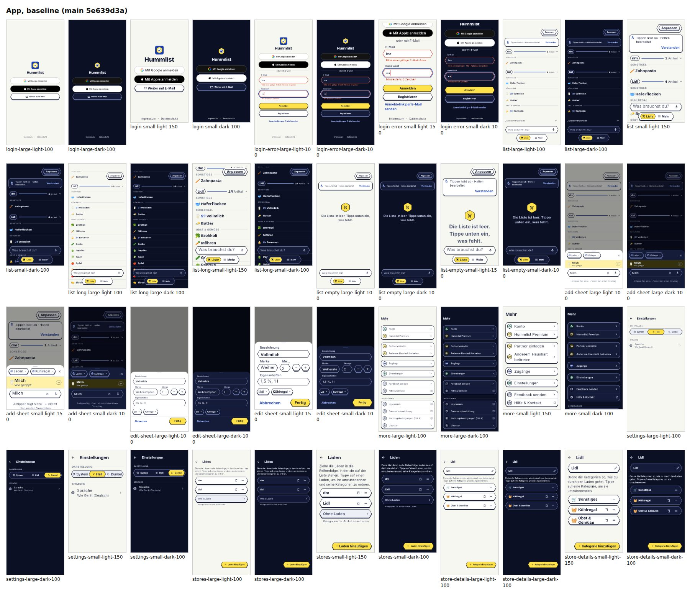
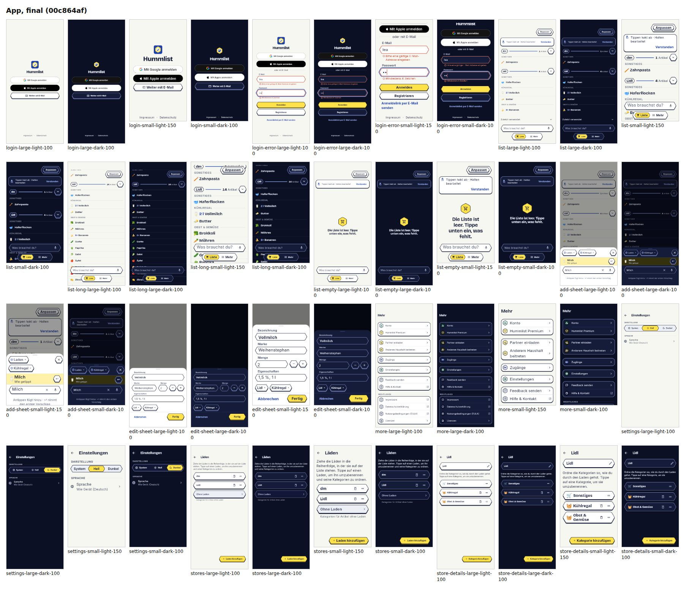
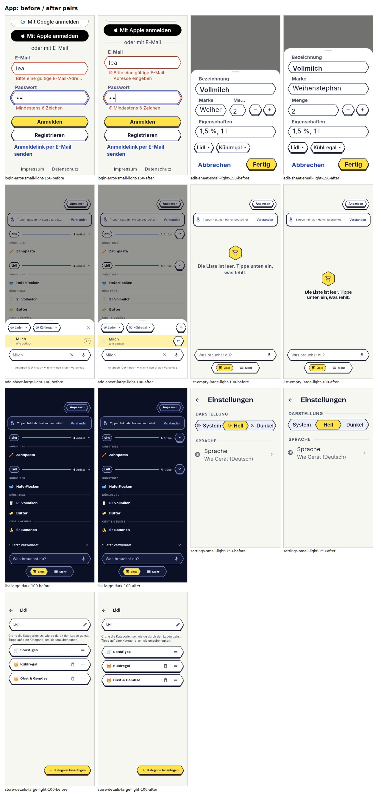

# Job 154: hill-climb hc-design-v2-app (app design, frozen rubric, blind council)

PR #300, closed: its app commit landed through #320 (job 154c). The site's half is PR #299
(`docs/done/154-hc-design-v2-web.md` there).

## Result

Score (minimum aspect median, median of 3 runs) **4 -> 5**, mean of aspect medians 5.33 -> 6.22,
noise band 1, so the absolute +1 equals the noise band; the final blind pairwise below is the
stronger evidence. 12 measured steps: 11 kept, 1 reverted; one more hypothesis dropped before measuring.
A final blind pairwise of baseline against final prefers the final state on all 9 aspects. Per
aspect, every step and every seed: `docs/hillclimb/hc-design-v2-app.md`.

## Kept steps

1. Field errors wrap instead of ending in an ellipsis (theme `errorMaxLines`).
2. The edit sheet stacks brand and quantity when the row does not fit (375 px, large text).
3. The add sheet's return key and close button are visible 52 x 48 hex keys.
4. Hex labels keep clear of the hex points at large text (segments drop icons, pill titles pad,
   chip insets scale).
5. Section overlines at 12 px through one shared style.
6. Edit-sheet chips and footer align to the fields' 16 px column.
7. Inline field errors carry an error icon; each field keeps the message as its semantics hint.
8. Stores screens separate the intro from the list (one 16 px gap).
9. The store header's fold chevron sits in a visible hex key (hierarchy voted for the baseline).
10. The empty list's sentence is the screen's heading, centred clear of the add field.
11. Fold-out chips are full-height targets (48 px box, 44 px face) in both sheets.

Reverted: the add sheet's bottom band growing with its wrapped hint (it lifted the add field into
the empty-state heading). Dropped: a status-bar backing (the app already has one; see DECISIONS).

## Method

- A rubric researched once and frozen before any baseline: 10 aspects (typography, hierarchy,
  colour and contrast, spacing, layout, design-system consistency, accessibility, motion,
  iconography, empty and error states), 7 checkable criteria each with cited sources (WCAG 2.2,
  Apple HIG, Material 3, Refactoring UI, NN/g, Butterick), anchors at 1/5/7/9/10, and the product
  rules as constraints. Motion is not scorable from stills and is left out of the score.
- Three fresh Claude Opus judges per measurement, each its own process in an empty directory with
  only the screenshots, the frozen DESIGN.md and tokens copies, and the rubric in the prompt; no
  scores, steps, diffs or "which is new". Aspect = median of the judges, score = minimum aspect
  median, the mean is reported too.
- Blind pairwise per step: baseline (best kept state) and candidate as "Version P"/"Version Q" in
  random order per judge (seeds logged). Keep = pairwise majority for the candidate, the minimum
  not below the best kept state minus the noise band, and every guardrail green.
- The harness (rubric, prompts, council runner, capture, guards) lives in the job's ops
  directory, never in this repo. It refuses to score when a frozen input's hash changes (proved
  with a tampered copy). Baseline: 3 absolute runs plus 3 A-vs-A pairwise runs (identical images:
  every vote was "tie").

## Guardrails

Every kept step: only `app/lib`, `app/test` and these docs changed; ARB/l10n byte-identical; no
changed UI string literal; `_SyncIndicator` untouched; `flutter analyze` clean; the app suite
(2048 passed, 90 skipped at the end) and the widgetbook suite (334) green; goldens updated only for
the screens the kept step changed, after the keep. New tests: edit sheet reflow, hex label
clearance, field-error icon and semantics (login, name dialog, feedback node kept while the error toggles), empty list clear of the add field.

## How to verify

`cd app && flutter analyze && flutter test`; look at `docs/screenshots/154/`. Re-measuring needs
the job's ops harness (outside this repo).

## Open

- Harness fidelity gaps (frozen, constant across both sides of every pairwise): no status bar is
  drawn, and More/settings/stores render without the pill tab bar.
- The floating Anpassen pill covers the store header's count at 150 % text on a 375 px phone;
  left alone because PR #296 is changing that bar.
- Decisions: DECISIONS.md "Job 154".
