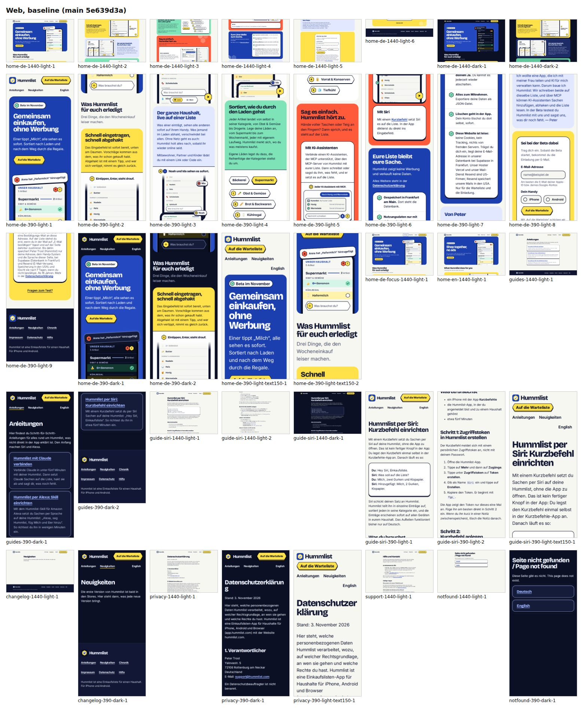
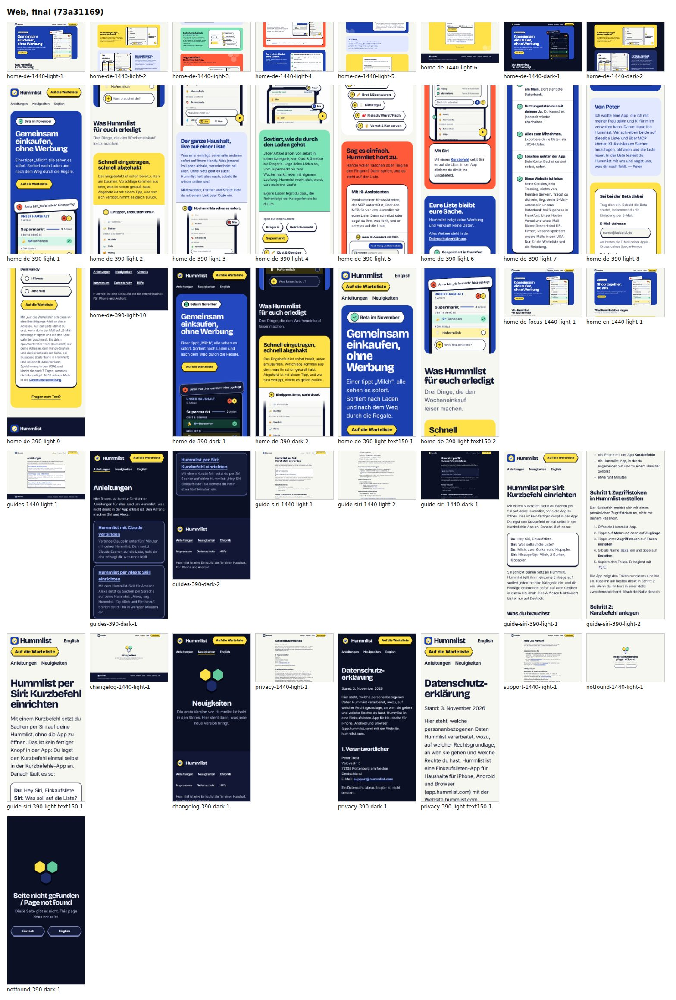
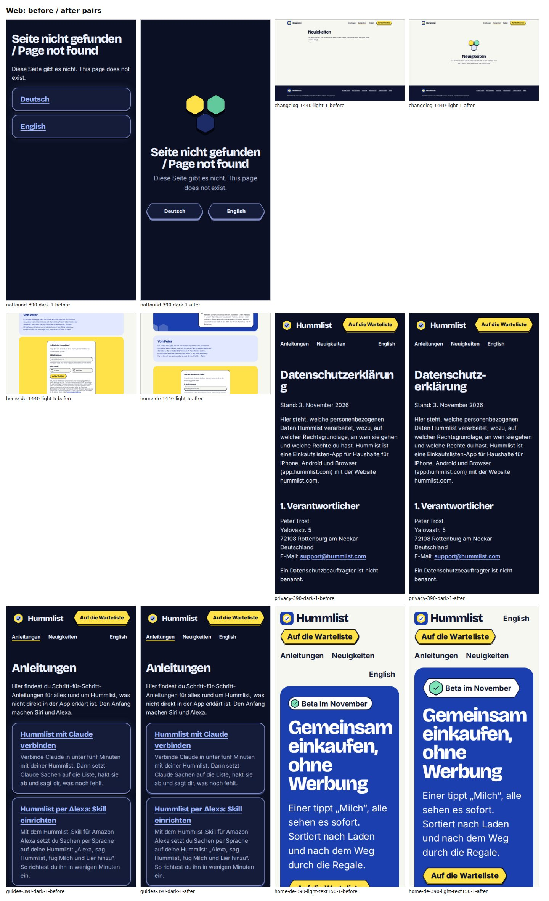

# Job 154: hill-climb hc-design-v2-web (hummlist.com design, frozen rubric, blind council)

PR #299, **DO NOT MERGE** (the lead reviews). The app's half and the job's DECISIONS section are in
PR #300 (`docs/done/154-hc-design-v2-app.md`).

## Result

Score (minimum aspect median, median of 3 runs) **4 -> 7**, mean of aspect medians 6.56 -> 7.67,
noise band 0.5. 12 steps, all kept. A final blind pairwise of baseline against final prefers the
final state on 7 aspects, 2 ties, none for the baseline. Per aspect, every step and every seed:
`docs/hillclimb/hc-design-v2-web.md`.

## Kept steps (CSS only, no words changed)

1. Dark-mode cards keep the hard 3D offset (was a blurred glow, a second depth style).
2. Empty changelog and 404 get a hex empty-state mark and a centred composition.
3. Headings hyphenate long German compounds on phones.
4. The waitlist field, phone radios and 404 links take the hex shape.
5. Waitlist fine print at line height 1.5 with a gap under the button.
6. Landing slabs share one inner padding (one start line).
7. Guide callouts get even inner padding.
8. 404 hex links use the hex button label (no link underline).
9. The header nav reflows evenly at large text (no orphaned language link).
10. Landing slabs get room between them (32 / 48 px).
11. Display headings breathe from 720 px (less negative tracking).
12. The hero status chip is a hex.

## Method

- A rubric researched once and frozen before any baseline: 10 aspects (typography, hierarchy,
  colour and contrast, spacing, layout, design-system consistency, accessibility, motion,
  iconography, empty and error states), 7 checkable criteria each with cited sources (WCAG 2.2,
  Apple HIG, Material 3, Refactoring UI, NN/g, Butterick), anchors at 1/5/7/9/10, and the product
  rules as constraints. Motion is not scorable from stills and is left out of the score.
- Three fresh Claude Opus judges per measurement, each its own process in an empty directory with
  only the screenshots, the frozen DESIGN.md and tokens copies, and the rubric in the prompt; no
  scores, steps, diffs or "which is new". Aspect = median of the judges, score = minimum aspect
  median, the mean is reported too.
- Blind pairwise per step: baseline (best kept state) and candidate as "Version P"/"Version Q" in
  random order per judge (seeds logged). Keep = pairwise majority for the candidate, the minimum
  not below the best kept state minus the noise band, and every guardrail green.
- The harness (rubric, prompts, council runner, capture, guards) lives in the job's ops
  directory, never in this repo. It refuses to score when a frozen input's hash changes (proved
  with a tampered copy). Baseline: 3 absolute runs plus 3 A-vs-A pairwise runs (identical images:
  every vote was "tie").

## Guardrails

Every kept step: only `site/public/*.css` and these docs changed; every page's words identical to
the base build (copy check, production and preview builds, 27 and 31 pages); the site gate
(169 tests at the end), `crawl.mjs` and `contrast.mjs` green. The branch was rebased onto main
after #290 (store chips), and the harness reference re-measured on the rebased head.

## How to verify

`scripts/gates/site.sh`; `cd site/checks && node crawl.mjs ../dist && node contrast.mjs ../dist`;
look at `docs/screenshots/154/`.

## Open

Floors at 7: typography (more than five type sizes on the landing), iconography (colour emoji in
the app mock-ups next to line icons), empty and error states (the empty changelog has no next
step; one needs new words).
