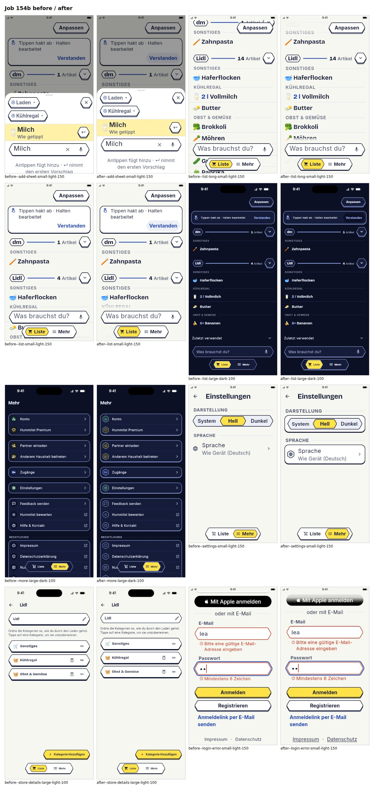

# Job 154b: app design climb on harness v3

Draft PR, **DO NOT MERGE** (the lead reviews). Continues job 154 (#300) on its app commit rebased
onto main.

## Result

- Score (minimum aspect median, median of 3 runs) **5 -> 6**, noise band 1. Final runs 6, 6, 6
  (baseline 5, 5, 6). Mean of aspect medians 6.44 -> 7.0.
- Per aspect (median of 3 runs), baseline -> final: typography 6 -> 7, hierarchy 6 -> 7,
  colour 7 -> 7, spacing 6 -> 7, layout 6 -> 7, consistency 6 -> 6, accessibility 6 -> 7,
  iconography 7 -> 7, empty and error states 8 -> 8.
- Blind pairwise, baseline against final: final 6 aspects, baseline 0, 3 ties.
- 12 steps: 10 kept, 2 reverted. Stopped at the step budget after 1 h 45 min.
- The log, every step's medians and the lowest aspect per step:
  `docs/hillclimb/hc-design-v3-app.md`.

## Kept steps

1. b1: the add sheet's hint is never cut off at large text.
2. b2: tabs, the hint card's Verstanden and the legal links show 44 pt targets.
3. b4: scrolled content fades out below the status bar.
4. b5: a scroll edge under the status bar and the top bar; More's dividers end inside the cards.
5. b6: dark mode draws the same 3D edge and hex buttons as light.
6. b7: one sheet scrim and one divider language.
7. b9: settings groups like More; More's row icons are line art in both modes.
8. b10: nothing a user must read is smaller than 13 px.
9. b11: rows fade out above the floating add field and tab pill.
10. b12: store details' name row is a field like every other field.

Reverted: b3 (list overline contrast, unseen in the pairwise) and b8 (a two-row page bar that
cost layout and accessibility).

## How to verify

- Run `cd app && flutter analyze && flutter test`: 2220 passed, 92 skipped. Widgetbook: 334.
- Look at `docs/screenshots/154b/` (before, after, pairs).
- Re-measuring needs the ops harness (`jobs/154b-hc-app-v2/harness-v3/measure.sh`).

## Open

- Consistency stays at 6. The judges name rounded cards next to hex rows (DESIGN.md specifies
  rounded cards), the Google/Apple pill buttons (brand rules), and Anpassen overlapping a store
  header at 150 % (`_Header`, held until Peter answers Q105). These are lead or Peter calls.
