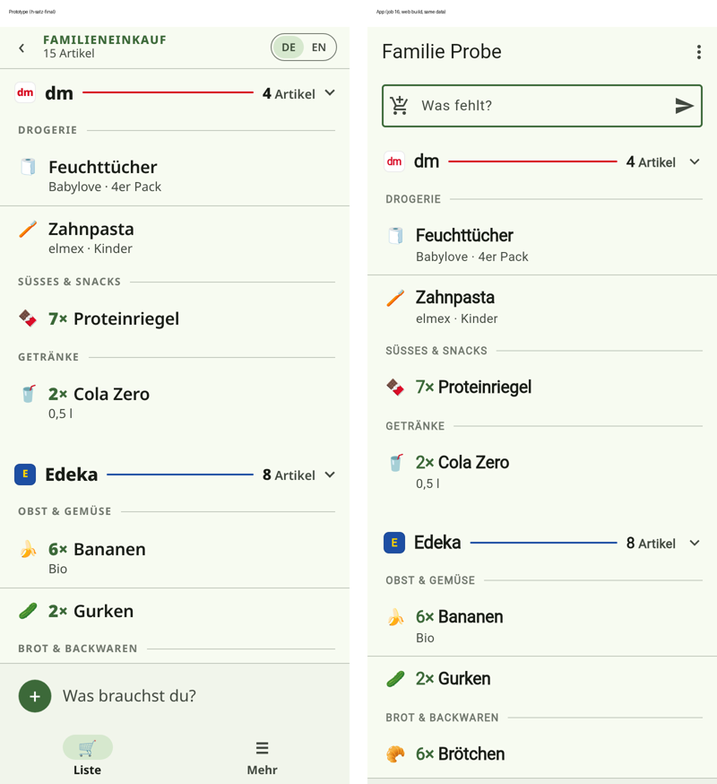
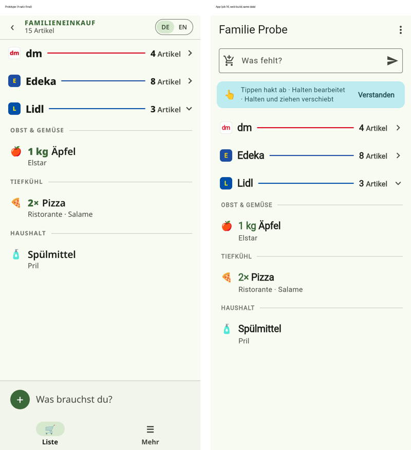
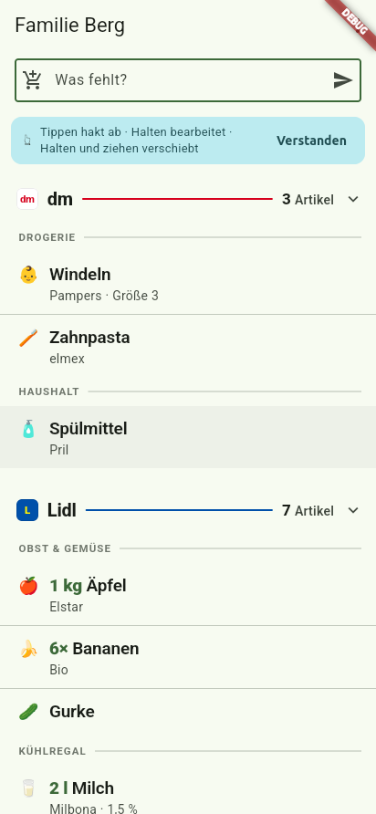
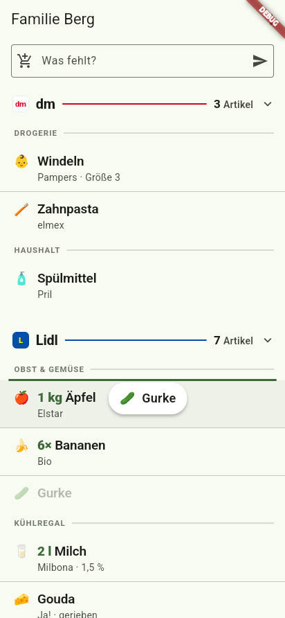
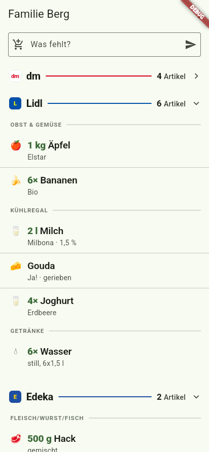
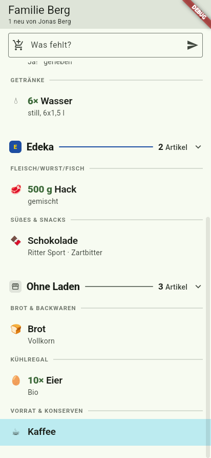
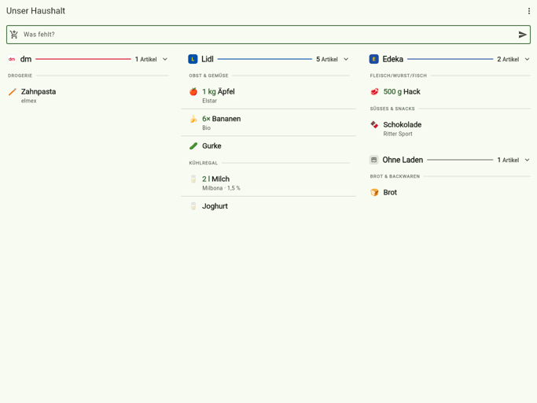
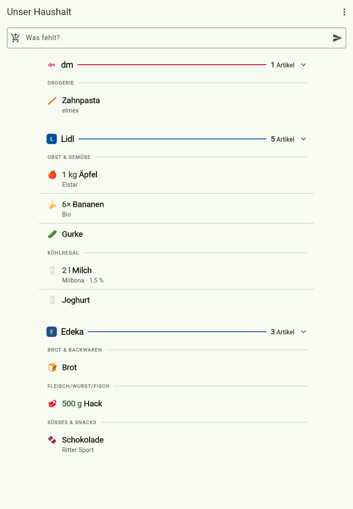

# Job 16: design H, part 2: the list

PR: https://github.com/trost-systems/family-groceries/pull/84

Peter approved design H ("Satz · Laufweg") on 2026-10-24. Job 15 laid the data (walk order, Marke, Eigenschaften, the move RPCs) and the edit sheet. This job builds what the list screen shows between the header and the add bar. Job 17 builds the add sheet and the app shell on top of it.

## What changed for users

- **Stores are sections.** Each store is a divider: badge, name, a rule in the store's colour, "N Artikel" and a caret. It scrolls away with the list; nothing sticks. Items without a store come last under "Ohne Laden". An empty store shows as "0 Artikel", so it stays a drop target.
- **One block per category, in the store's walk order.** Categories are small, faded capitals with a hairline. Inside a category the items follow their walk order (`sort_key`), the same on every device and after a reload.
- **Rows** are full width with a small emoji, a bold quantity first ("6×", "500 g"), the name wrapped in full and "Marke · Eigenschaften" under it. No check circle, no card, no added-by initial. A partner's new item keeps job 8's tint and "N neu von Lea" in the title.
- **Tap ticks.** The row fades and a line strikes through the name for 260 ms, then "<name> abgehakt" with Rückgängig. Undo puts it back in the same place. With reduced motion it ticks at once.
- **Hold edits, hold and move drags.** A hold that stays put (or a right click on web) opens job 15's edit sheet. A hold that moves lifts the item: drop it on the upper or lower half of a row to put it before or after it (a 3 px line shows where), on a category divider to put it at the end of that category, or on a store divider, folded or not, to move it to that store in its own category. The list scrolls when the item is held at its top or bottom edge.
- **Folding.** A tap on a store divider folds it to the divider alone. Folds survive restarts and reloads.
- **Reordering.** Hold and drag a category divider to reorder categories inside its store (the other categories fold while it moves). Hold and drag a store divider to reorder the stores (all stores fold while it moves). Holding a divider without moving, or a right click, opens a menu: "nach oben", "nach unten", and the store layout screen or the categories screen.
- **The explainer card** "Tippen hakt ab · Halten bearbeitet · Halten und ziehen verschiebt" sits at the top until "Verstanden"; that sticks.
- **Wide screens** (iPad, desktop web): from 840 px the stores go in two columns, from 1200 px in three, each a run of whole stores in household order, at most 560 px wide, balanced by height. From 600 to 840 px one centred column, at most 640 px. Drag and drop works across columns.
- **Gone:** the store filter chips ("Alle", dm, Lidl, Edeka) and, with them, the store views and the "gibt es bei" switches on the store layout screen. Folding replaces the filter (DECISIONS, Job 16; NEEDS_PETER asks whether Peter misses them).
- **Offline:** an item moved offline is queued and sent later, like any other item change. A store or category reorder needs a connection and says so instead of showing an order no one else sees.

## Where

- `app/lib/list/list_view/`: `shopping_list_view.dart` (the scroll view, columns, auto-scroll, ticking, edit, the divider menu), `sections.dart` (grouping, columns, drop maths, pure), `item_row.dart`, `dividers.dart` (store and category dividers), `drag.dart`, `explainer.dart`, `item_icon.dart`.
- `app/lib/list/list_screen.dart` keeps the scaffold, add field, usual chips, title, sync indicator and menu, for job 17 to replace.
- `app/lib/list/list_cubit.dart`: the store filter removed; `toggleFold`, `dismissHint`, `NeedsConnection`, catalog writes undone on failure. `list_cache.dart`: `ListPrefs`. `app/lib/app/device_cache.dart`: the `listprefs.` key.
- `app/lib/list/store_layout_screen.dart`: no switches.
- Strings: `app/l10n/app_de.arb`, `app_en.arb`.
- Tests: `app/test/list/sections_test.dart` (new), `list_screen_test.dart`, `list_cubit_test.dart`, `model_test.dart`; `e2e/tests/list-walk-order.spec.ts` (new), `stores.spec.ts` rewritten for sections, `classifier.spec.ts`, helpers in `e2e/tests/helpers.ts` and `catalog.ts` (`tick` waits for the tick to commit, `reveal` scrolls the lazy list, `outline`, `sectionHeadings`, `storeOf`, `holdAndDrop` with edge auto-scroll, `dragItemToStore`).
- Fixtures: `test/fixtures/scenarios/h-prototype.yaml` (the prototype's own list, for side-by-side screenshots); job 18's `h-list-walk.yaml` for the walk-through.
- Verify skill: `fg drag` (a real held drag on the Linux client, via xdotool), recipes updated for the new list and the new `features/list-walk-order.md`. `fg up` on the checkout's own stack no longer links `supabase/functions` into itself.
- `fg sync` (`e2e/sync/engine.mjs`, `e2e/sync-smoke.sh`): ticks by tapping, edits through the sheet, "shops at" a store by folding the others; the scenario docs and schema say so.
- Docs: `docs/DECISIONS.md` "Job 16", `docs/NEEDS_PETER.md` "Job 16", `docs/design/h-satz-final/SPEC.md` part 4 (the interfaces job 17 builds on).

## How to verify

```bash
cd app && flutter analyze --fatal-infos && flutter test
scripts/verify.sh --only e2e -- tests/list-walk-order.spec.ts tests/stores.spec.ts
FG_SURFACE=linux scripts/fg up --clients peter,lea      # then .cursor/skills/verify-family-groceries/features/list-walk-order.md
```

## Results

**CI.** `ci-ok` is green on 8f5f269, the PR's single commit at the time: [run 40817873361](https://github.com/trost-systems/family-groceries/actions/runs/40817873361). Both e2e shards passed 40 of 40 each with no retries, and the `fg sync` smoke test passed (add and tick across two clients, plus both SIGTERM cases). db (pgTAP), flutter, functions, fg-cli, lint, gitleaks, site and web-prod passed too. Only this summary and the PR description changed after that run; the landed commit's own run is in the PR's checks.

**Earlier CI runs on this PR, both red, both fixed in the test helpers:**
- [Run 40807613869](https://github.com/trost-systems/family-groceries/actions/runs/40807613869): the wide-layout test timed out. The drag helper waited for its target to move 60 px inside the list, which a divider at the very top of the list never does. It now stops once the target is on screen and the list has stopped scrolling.
- [Run 40813343875](https://github.com/trost-systems/family-groceries/actions/runs/40813343875): the same test again (the helper measured the list's top 12 px too low), and the classifier spot check, which asserted a row below the fold of the lazily built list. It now scrolls to it like a user.

**Review 0 (FIX) and what changed:**
- The red `stores.spec.ts` re-add was a race in the test, not the store memory. A tap ticks after a 260 ms leave animation, and the spec typed "Zahnpasta" again right after the tap, so the add found it still on the list ("steht schon"). The `tick` helper now waits for the "<name> abgehakt" snackbar, which shows when the tick commits. Every spec that ticks goes through it.
- The hidden-at-store flag: nothing in `supabase/` reads it besides the layout writers, and no function, MCP tool or voice path uses it. Older app builds keep their data (DECISIONS, Job 16, 2).
- `fg sync` (job 18's multi-client driver, `e2e/sync/engine.mjs`) ticked through the old check box and picked store chips. It now taps rows, edits through the sheet, and "shops at" a store by folding the others (keeping "Ohne Laden" open). It dismisses the explainer card after sign-in. The smoke script has both clients shop at "Ohne Laden", where the new item lands, so it is on screen.
- The "Ohne Laden" divider opens its menu on a hold too (it has no drag). The categories screen's hint no longer mentions "Alle".
- The branch is rebased onto main (DECISIONS and DONE_SUMMARY kept both sides; #81's recipe fixes are in the H versions of `classifier.md` and `stores.md`) and pushed as one commit with `push-pr.sh`.

**Local runs** (551xx stack, `--workers=1`, under the e2e lock):
- `flutter analyze --fatal-infos` is clean, and `flutter test` passes 316 tests.
- The lint gate passes, and so does fg-cli (56 passed).
- The full e2e gate passed 79 of 80. The 80th, the wide-layout test, failed during a 1344 s VM pause and passed on the excused retry. Later, `list-walk-order`, `stores` and `classifier` passed twice in a row (`--repeat-each=2`), and the sync smoke passed.

**Real app** (Linux debug build under Xvfb, `scripts/fg`, the `h-list-walk` scenario, Hanna on one client and Jonas on the other):
- A tap ticks Gurke, and Rückgängig puts it back at sort_key 3072, where it was.
- A held drag puts Gurke before "1 kg Äpfel" and then, with `fg drag --edge after`, after "6× Bananen". The DB order follows both times.
- Folding dm survives `fg restart`. Gurke dropped onto the folded dm moved there and kept "Obst & Gemüse".
- Jonas's add (`fg peer`) shows tinted on Hanna's client with "1 neu von Jonas Berg" and no initial.
- Jonas's drag of Joghurt above Milch on his client showed up live on Hanna's.
- The verify-skill subagent then ran every changed recipe live on the same stack, and all passed: `list-walk-order`, `stores`, `categories`, `quick-add`, `classifier`, `live-sync` and `edit-item`. Its evidence and a recording of the partner move are in `~/fg-evidence/job16/run-20261028-212133/` on the box.

## Screenshots

All in `docs/screenshots/job-16/`.

| | |
| --- | --- |
|  | The prototype (left) and the app (right) on the same data (`h-prototype`), 390×844. |
|  | dm and Edeka folded, prototype and app. |
|  | The Linux app (`fg`, 412×892) on `h-list-walk`. |
|  | A drag in progress: the lifted pill, the faded source and the insertion line above "1 kg Äpfel". |
|  | dm still folded after an app restart, and Gurke dropped onto it (4 Artikel). |
|  | Jonas's live add: tinted, "1 neu von Jonas Berg", no initial. |
|  | 1366×1024 (iPad landscape): three columns. |
|  | 820×1180 (iPad portrait): one centred column. |

Also: `linux-02-ticked-undo-snackbar`, `linux-04-folded`, `linux-06-partner-new`, `linux-07-partner-move-live`, `walk-01-list`, `walk-02-folded`, `walk-03-drag-insertion-line`, `walk-04-rows`.

## Prototype compared with the app

Same data (`h-prototype`), 390×844, web build. The dividers, rule colours, counts, carets, category labels, row padding, quantity prefix, second line, emoji and spacing match. The differences, each with its reason:

- **Header, add bar and tabs.** The app still has the old header and the add field on top; the prototype's header, bottom input and tabs are job 17's.
- **Explainer card.** The app shows it until "Verstanden"; the prototype's screenshot was taken after dismissing it. Intended (Peter: "kept and can be dismissed").
- **Font.** Flutter web draws Roboto; the prototype's screenshot used the browser's system sans. Weight 650 renders as the nearest weight. Flutter limitation; on iOS both use San Francisco.
- **Emoji.** The prototype's mock data hand-picks one per item; the app derives it from the name, else the category (DECISIONS, Job 16, 8). On this data they match; an item the name table doesn't know shows its category's emoji.
- **Empty stores.** The app shows a store without items as "0 Artikel"; the prototype hides it. Decided so items can be dropped on it (NEEDS_PETER asks).
- **"Verstanden"** is 44 px tall (the tap-target rule), the prototype's 36 px.

## Missing or blocked

Nothing blocks. NEEDS_PETER.md has two reversible questions: whether he misses the store chips, and whether empty stores should hide.
