# Job 17: design H, part 3: add sheet, app shell, English

PR: https://github.com/trost-systems/family-groceries/pull/89

Peter approved design H ("Satz · Laufweg") on 2026-10-24. Job 15 laid the data and the edit sheet, job 16 the list. This job builds the add bar and the add sheet, the app shell with the List and More tabs, the settings under More, and English for the whole app. With it, design H is complete.

## What changed for users

- **The input is at the bottom**, above the tabs: a "+" disc, "Was brauchst du?" and, on phones, the microphone.
- **Typing opens the add sheet.** It grows upwards around the input, which stays where it is; the tabs slide away and their band says "Antippen fügt hinzu · ↵ nimmt den ersten Vorschlag". The sheet is exactly as tall as what it shows (no 50 % floor, Peter's decision) and scrolls only once it reaches the top of the screen.
- **Every row is tappable.** First the entry as typed, read by the server's parser ("Windeln Pampers Größe 3": Windeln, Pampers, Größe 3, dm). Then what the household bought before, other packs and details it bought, the next and previous size, other brands, and dictionary words that start like the last word. Each row says where it comes from (Wie getippt, Schon mal gekauft, Andere Packung, Andere Sorte, Andere Größe, Andere Marke, Aus dem Katalog), and what differs from the first row is bold.
- **Two steps: type, then tap.** Enter takes the first row. The store and category chips fold out their options; a pick applies to the row that is tapped next and is learned for next time. After an add, "✓ Hinzugefügt: Windeln → dm" with Rückgängig; the input is empty and keeps focus for the next item.
- **Nothing typed:** the sheet offers what is due again ("Wieder fällig"), or says "Tippe, um Vorschläge zu sehen".
- **Close** with Schließen, Escape or a tap on the dimmed list.
- **Two tabs, Liste and Mehr** (a rail from 840 px). The List header shows the household's name in capitals (Hummlist without one), "N Artikel", "N neu von Lea" and the sync state. The old menu is gone.
- **More:** invite a member, join another household, categories, a new Läden screen (store order and each store's walking order), Zugänge (MCP, tokens, connected apps), Konto (export, delete), Abmelden, Sprache (Wie Gerät, Deutsch, English), Impressum, Datenschutz, Lizenzen, and the version.
- **English throughout.** The app follows the device's language (German for anything but German and English); Sprache overrides it at once and keeps the choice on the device. Seeded categories the household has not renamed show their English names.
- **Wide screens:** a navigation rail, a sheet at most 640 px wide under the list column, and More with its list beside the selected page.

## Where

- `app/lib/list/add_sheet/`: `add_sheet.dart` (scrim, surface, header, chips, rows, note), `add_sheet_cubit.dart` (text, picks, fetching with debounce, cache and offline fallback, the add), `suggestion.dart`.
- `app/lib/list/list_screen.dart`: header, add bar, wiring; `dictation_button.dart` (the microphone on its own, for job 10).
- `app/lib/app/shell.dart` (tabs, rail, `SheetOpen`), `router.dart` (`StatefulShellRoute`: `/`, `/more`, `/more/privacy`, `/settings`), `language.dart`, `app.dart`, `device_cache.dart` (`language`), `guides.dart` (imprint URL, `privacyPolicyUrl`).
- `app/lib/list/list_scope.dart`: the list cubit for both tabs, refused-write notices wherever the user is.
- `app/lib/more/more_screen.dart`, `stores_screen.dart`; `app/lib/settings/settings_screen.dart` restyled as a More page.
- `app/lib/list/category_names.dart`; `list_cubit.dart` (`addParsed`, same-item check with brand and details, `suggest`); `foldout_chips.dart` (automatic store label, tap-only semantics).
- `supabase/migrations/20261029105411_suggest_entries.sql`: `public.suggest_entries`, `public.guess_store`, learning on insert. Tests: `supabase/tests/suggest_entries.test.sql`.
- Strings: `app/l10n/app_de.arb`, `app_en.arb` (all 223 keys in both). New dependency: `package_info_plus`.
- Tests: `app/test/l10n/arb_parity_test.dart`, `test/list/add_sheet_test.dart`, `add_field_autofocus_test.dart`, `test/app/shell_test.dart`, `language_test.dart`, `test/more/`; e2e `e2e/tests/add-sheet.spec.ts`, `shell-more.spec.ts`, and every spec the new add flow and shell touched (helpers `addItem`, `enterItem`, `closeSheet`, `openMore`, `openTab`).
- Verify skill: `features/shell-more.md` (new), `quick-add.md` rewritten, account, auth, categories, mcp-access, voice, household, live-sync, stores, classifier, list-walk-order, the journeys and `fg logout`.
- Decisions: `docs/DECISIONS.md`, "Job 17". Open items for Peter: `docs/NEEDS_PETER.md`, "Job 17".

## How to verify

```bash
supabase db reset && supabase test db
(cd app && flutter analyze --fatal-infos && flutter test)
scripts/lint.sh
scripts/verify.sh --only e2e -- tests/add-sheet.spec.ts tests/shell-more.spec.ts
FG_SURFACE=linux scripts/fg up --clients peter   # then features/quick-add.md and features/shell-more.md
```

## Results

- **Flutter:** `flutter analyze --fatal-infos` clean; `flutter test` 374 passed, none skipped (on the Mac, final head).
- **pgTAP:** all files pass on a reset stack (41 tests in `suggest_entries.test.sql`; the final head's run is CI's `db` job). `scripts/lint.sh` passes.
- **e2e (local, 552xx stack, `--workers=1`, under the lock):** a full run on the second-to-last head passed 87 of 90; the three failures (two edit-sheet tests, the conventions check) were fixed in the last head and pass, together with the add-sheet spec (6 tests, also 3× repeated) and shell-more (5 tests). The `fg sync` smoke passed.
- **CI:** green on 05096e9, whose code is what main takes (later heads add this doc and rebase onto job 27's CI changes; `merge-pr.sh` merges only after `ci-ok` on the final head as well): https://github.com/trost-systems/family-groceries/actions/runs/40921586580 (gitleaks, lint, site, db, functions, fg-cli, flutter, web-prod, android, ios, e2e 1 and 2, ci-ok). The run before it (40918953410) failed only `stores.spec`'s journey on the 60 s timeout, fixed above; no flaky reruns.
- **Real app (Linux debug build, `scripts/fg`, 412×892):** typed and tapped adds, a store chip applied to a tapped alternative (DB: Windeln / Huggies / Größe 3 / Lidl), the sheet growing (recording), More, licenses, English applied live and kept across `fg restart` and sign-out, sign-out and sign-in. The verify-skill pass ran quick-add, shell-more, auth, account and the quick-add-live-sync, mcp-disconnect and account-deletion journeys: all PASS (evidence `~/groceries-ops/evidence/job17*` on the box).
- **Motion (Chrome, rAF intervals while the sheet grows from 2 to 8 rows):** after the first, cold open every frame was 17 ms (60 fps, 60 frames); the very first open had two long frames (83 and 100 ms) while the rows were built and their glyphs shaped for the first time. Only the surface's size animates; the rows are laid out once (the review's reflow concern).

### Bugs found and fixed on the way

- On web a tap on a Material button's semantics node (Rückgängig, Schließen, the chips) took the add field's text connection with it: the cursor blinked, the DOM input filled, the app got nothing. Those controls now expose a tap-only semantics node like the rows; e2e tests type after each of them without a click.
- Refocusing selected the whole text (web/desktop default), so the next key replaced it: `selectAllOnFocus: false`.
- The scrim's unnamed semantics node blocked clicks on the list after closing; it is decoration now (Schließen and Escape close for everyone else).
- Closing left the typed text in the field; it starts blank now, also when reopened quickly.
- A refused write (category name taken) was told only in the List tab; it now shows wherever the user is.
- Short windows overflowed the empty sheet; with little room everything scrolls.
- Android back on Zugänge/Konto would have left the app; it goes to More.
- The edit sheet opened inside the List tab above the tabs; it covers the whole app again.
- Under reduced motion the sheet skips `AnimatedSize` (it asserted in debug with a zero duration).
- The English scan found the category divider's screen-reader name still German; seeded names are localized there too.
- A tick commits 260 ms after the tap and then ends typing; a tap on the field inside that window lost what was typed next. A late list interaction no longer unfocuses the open sheet's field (found by CI's `stores.spec`).
- Suggestions are cached per text only until the next add or opening, so an answer from before a store change is never reused. An answer still on its way during an add is not cached either (review).
- Review of 9dc1304 (independent agent, no must-fix), all fixed:
  - Tapping an old purchase taught its old category or store back over a newer correction. Every suggestion row now carries the store and category the list guesses now, so only chip picks teach.
  - Rückgängig after an add removed the item but kept what a chip pick taught. A delete within 10 minutes of the add takes the lesson back (`items_unlearn_delete`), and putting a deleted item back teaches nothing.
  - The duplicate check compared Eigenschaften in their typed order; now in any order.
  - An unknown `/more/…` path showed go_router's error page; it goes to the list.
- CI on the rebased head: `stores.spec`'s store journey ran past the 60 s test timeout (it took 46–55 s on main already); it has 120 s now.

## Screenshots

All in `docs/screenshots/job-17/`.

| | |
| --- | --- |
| 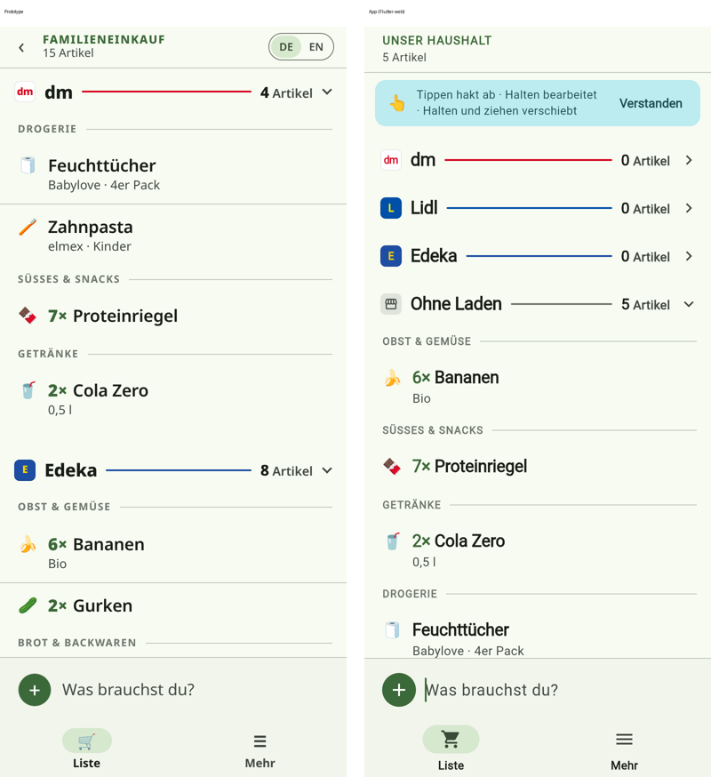 | Prototype (left) and app (right), closed bar, 390×844. |
| 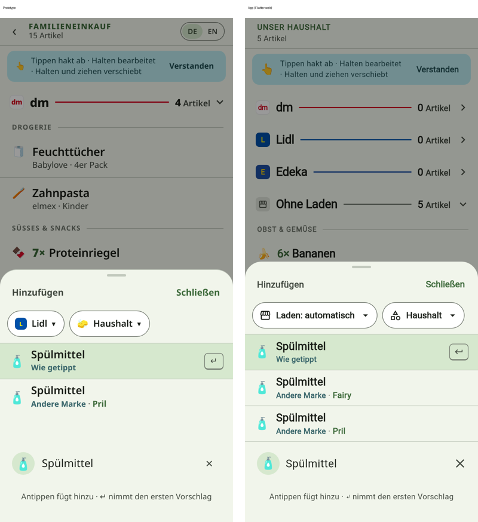 | "Spülmittel": the app's sheet hugs its three rows. |
| 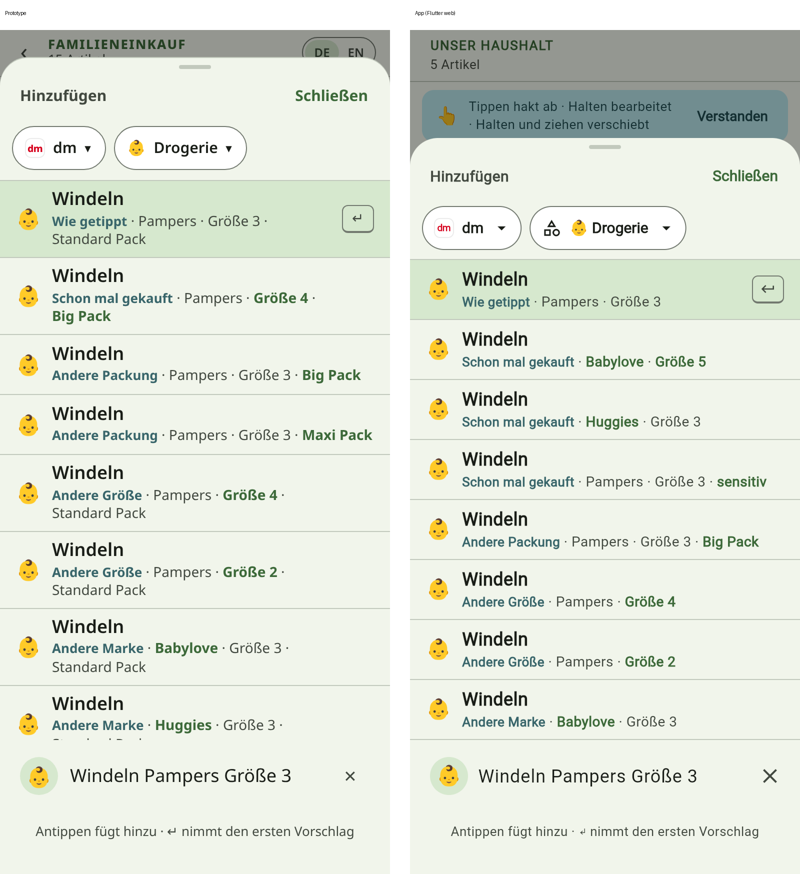 | "Windeln Pampers Größe 3", eight rows. |
| 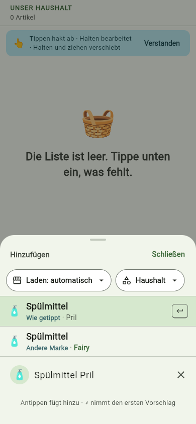 | Two rows: no dead band, under half the screen. |
| 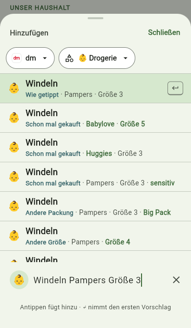 | Eight rows on a 667 px phone: full height, then the rows scroll. |
| 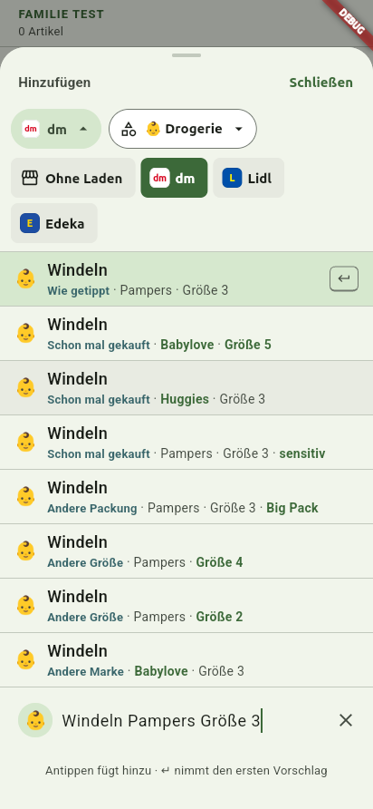 | Linux: the store chip folded out. |
| 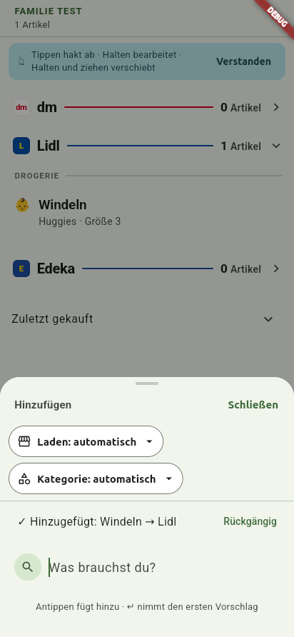 | Linux: Huggies picked with Lidl, "Hinzugefügt: Windeln → Lidl". |
| 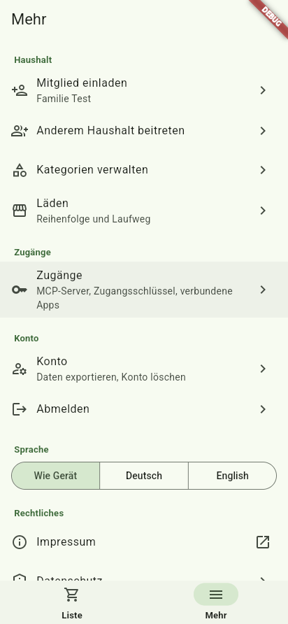 | More. |
| 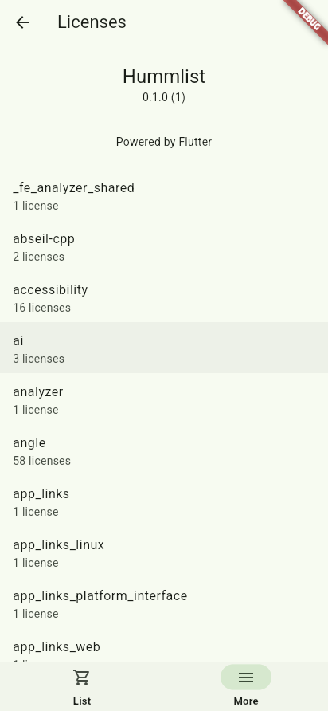 | Lizenzen: Hummlist 0.1.0 (1). |
| 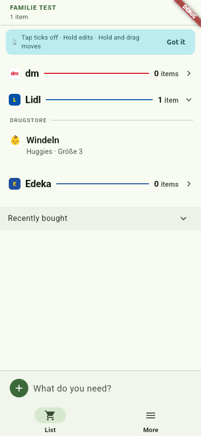 | English, after a restart. |
| 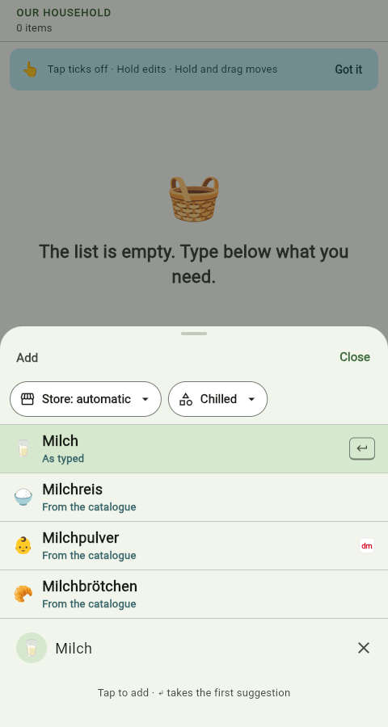 | English add sheet (English browser). |
| 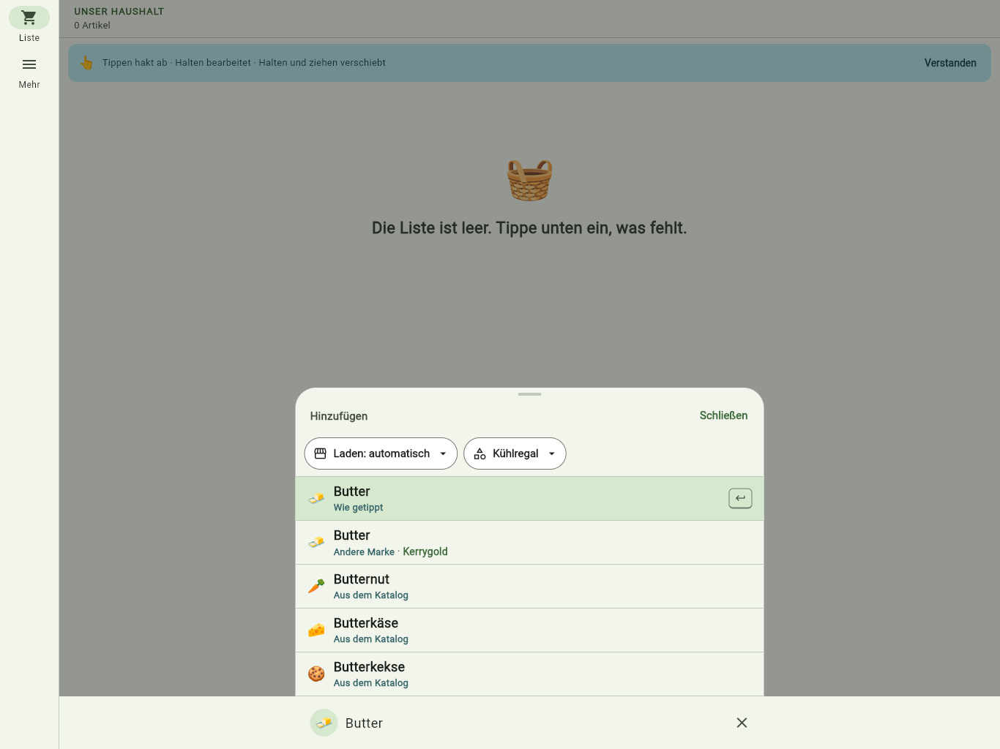 | 1366×1024: rail, 640 px sheet. |
| 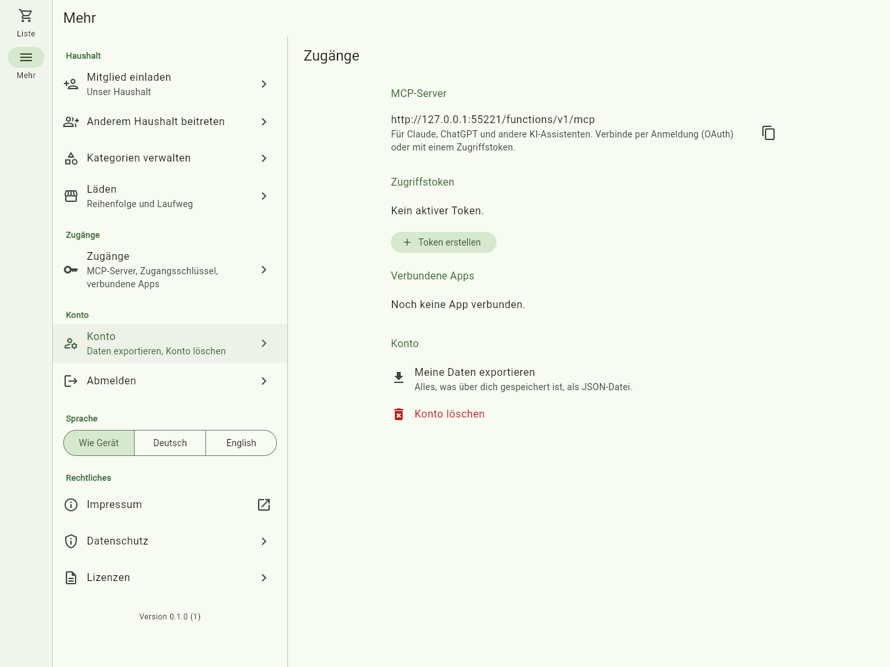 | 1366×1024: More in two panes. |
| 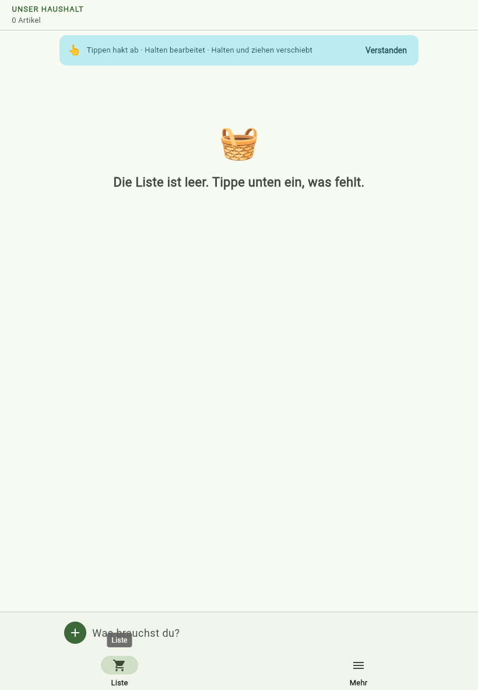 | 820×1180. |

Also: `web-add-01-closed`, `web-add-4-Mi`, `web-add-6-Butter`, `web-add-8-Windeln-Pampers-Groesse-3`, `web-add-chip-picked`, `web-add-due`, `web-more-*`, `web-en-02-list`, `web-en-03-settings`, `linux-01-closed`, `linux-03-windeln`, `linux-09-list-english`, `linux-13-signed-out`, and the recording `linux-sheet-grow.webm`.

## Prototype compared with the app (390×844, same queries)

- **Sheet height.** The prototype keeps a 50 % minimum and leaves a band under two rows; the app hugs its rows. Peter's shrink-to-fit override.
- **"Spülmittel" has three rows, not two.** The brand list knows Fairy and Pril; the prototype's mock catalogue knew only Pril. Data, not layout.
- **Eight rows end below the top on 844 px.** The prototype's mock adds "Standard Pack", so its rows wrap to two lines; the app's have one. On a 667 px phone the eight rows reach the top and scroll (screenshot above). Data.
- **Packs, sizes and brands come from the household's history and the brand list**, not from a product catalogue the app doesn't have (DECISIONS, Job 17, 1).
- **Header.** The household's name, not "FAMILIENEINKAUF"; no DE/EN toggle and no back link (language is under More). Peter's decisions.
- **Store chip.** "Laden: automatisch" when the parser knows no store; the prototype's mock memory always had one. Data.
- **Category chip and options** lead with a generic category icon: the app's categories carry no emoji (job 15's decision).
- **Tabs and icons.** Material icons (cart, menu) in place of 🛒 and ☰, as SPEC 2.12 allows.
- **Font.** Roboto on web and Linux; the prototype used the browser's system sans. Flutter limitation; iOS uses San Francisco in both.
- **Closed bar.** No outlined pill: the prototype draws it behind the sheet, so its own screenshots have none either (DECISIONS, Job 17, 9).
- **Wide layouts** are the app's own; the prototype is phone-only.

## Missing or blocked

- **Datenschutz** has no text: an in-app page marked "Entwurf" until Peter publishes one (`privacyPolicyUrl`, NEEDS_PETER).
- **Impressum** links hummlist.com/impressum, which answers 404 until the guides site is deployed (NEEDS_PETER).
- **Server texts** (MCP and voice answers, emails) stay German; out of scope for this job.
- No spring for the sheet: `AnimatedSize` with emphasized easing (DECISIONS, Job 17, 7).
