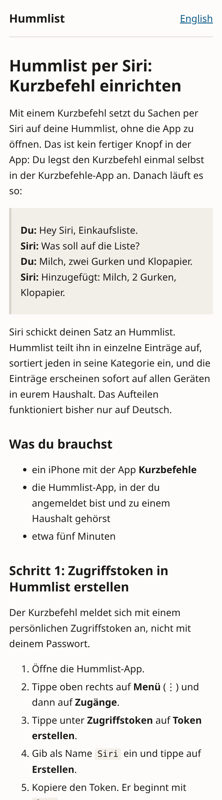
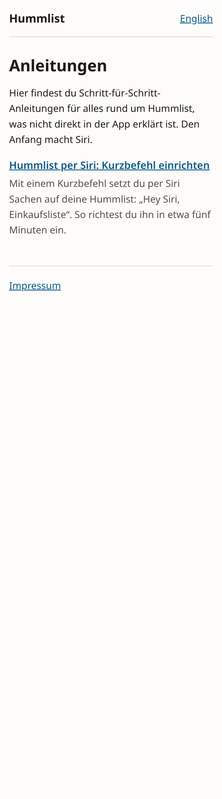
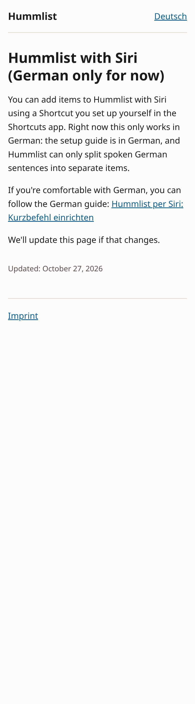
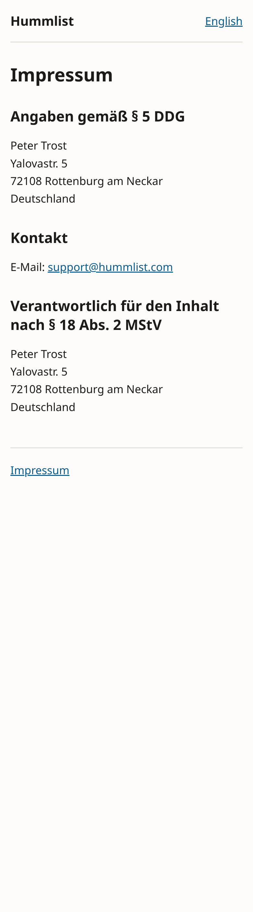

# Job 24a: guides site on hummlist.com

PR: https://github.com/trost-systems/family-groceries/pull/54

## What was built

- `site/`: a static site generated from Markdown (`site/build.mjs`, markdown-it and
  gray-matter), no JavaScript in the browser. `site/README.md` explains adding a guide.
- Content: the Peter-approved Siri guide (German) and its English stub, the two index intros, and
  the Impressum in German and English. The guide bodies are byte-identical to the approved copy;
  only `translation_key` and `updated` were added.
- `site/vercel.json`: the Vercel project config (install `npm ci`, build `npm run build`, output
  `dist`, clean URLs, `/` redirect by Accept-Language, CSP and security headers, noindex).
- `site/scripts/preview.mjs`: a local server on port 55990 that applies `vercel.json`'s
  redirects and headers.
- CI gate `site` (`scripts/gates/site.sh`): 37 tests, a production build, and a repo-wide check
  for a real access token.
- App: `app/lib/app/guides.dart` (`guidesBaseUrl`, `siriGuideUrl(languageCode)`) and its test.
  The app has no Siri setup entry point, so there is no new UI.

Decisions: `docs/DECISIONS.md`, "Job 24a". Open items for Peter: `docs/NEEDS_PETER.md`, "Job 24a".

## Routes

| Route | Page |
| --- | --- |
| `/` | 307 to `/de/anleitungen` (Accept-Language `de…` or none) or `/en/guides` (any other language) |
| `/de/anleitungen` | German index |
| `/de/anleitungen/siri-kurzbefehl` | Hummlist per Siri: Kurzbefehl einrichten |
| `/en/guides` | English index |
| `/en/guides/siri-shortcut` | Hummlist with Siri (German only for now) |
| `/impressum`, `/en/imprint` | Impressum, Imprint |
| anything else | 404 page, German and English |

Footer: Impressum/Imprint always. Datenschutz/Privacy and Hilfe/Support appear only when
`site/config.json` sets `legalPublished: true`; job 24 adds those pages.

## For the Lead: Vercel project

Root Directory `site`. Everything else comes from `site/vercel.json`: install `npm ci`, build
`npm run build`, output directory `dist` (that is, `site/dist`), Framework Preset none. Production
builds fail while a page still contains a `[PETER:` placeholder; none are left. The app project
(app.hummlist.com) also redeploys when only `site/` changes. Its output is the same (below), so
an "Ignored Build Step" for `site/`-only pushes is optional and is the Lead's call.

## Verification

- `cd site && npm test`: 37 of 37 pass. `VERCEL_ENV=production npm run build`: 7 pages, no
  warnings.
- `flutter test test/app/guides_test.dart`: 3 of 3 pass.
- App build unchanged: `flutter build web --release` with the production defines, run on `main`
  (2e76190) and on this branch with `site/` and `guides.dart` present. All 44 output files have
  the same SHA-256 (`main.dart.js` `be4bc6e7…`). The root `vercel.json` builds only `app/` into
  `app/build/web`.
- Root redirect on the preview server: `de-DE,de;q=0.9` to `/de/anleitungen`,
  `en-US,en;q=0.9,de;q=0.8` to `/en/guides`, no header to `/de/anleitungen`.
- Lighthouse 12, mobile, headless Chromium, against the preview server (with its headers):

  | Page | Performance | Accessibility | Best practices | SEO |
  | --- | --- | --- | --- | --- |
  | `/de/anleitungen/siri-kurzbefehl` | 100 | 100 | 100 | 63 |
  | `/en/guides/siri-shortcut` | 100 | 100 | 100 | 63 |
  | `/de/anleitungen` | 100 | 100 | 100 | 63 |
  | `/impressum` | 100 | 100 | 100 | 63 |

  The only failing SEO audit is "Page is blocked from indexing", which is the intended noindex.

Screenshots (390 px wide, 2x):

## Acceptance criteria (Spec #5)

| AC | Status | Evidence |
| --- | --- | --- |
| 1 DE/EN guide renders; indexes list only their own locale with title and description | done | tests "real content builds every route", "each index lists only its own locale…"; screenshots |
| 2 a new file appears at its route and index; missing frontmatter fails clearly | done | tests "a new guide file appears…", "a guide missing … fails naming file and field" |
| 3 language switch to the translation, else the other index | done | tests "the Siri guide pair switches language…", "a guide without translation links to the other index…" |
| 4 html lang, hreflang for existing versions plus x-default | done | same tests; x-default is the German version |
| 5 static; Lighthouse mobile perf >= 90, a11y >= 95 | done | 100/100 on four pages (table above) |
| 6 one h1, ordered headings, alt text, automated | done | build checks plus tests for each failure |
| 7 no cookies, trackers or third parties, automated | done | tests "every page carries the privacy headers and no cookie", "no file in the build has a script or an external resource" |
| 8 repo token check | done | `scripts/gates/site.sh` `git grep` and the content/dist test |
| 9 EN stub says German only | done | test "the EN stub says German only…" |
| 10 footer links privacy and support | waiting for job 24 | rendered once `legalPublished` is true; Impressum is always linked; tested both ways |
| 11 OG and Twitter tags from frontmatter | done | test "OG and Twitter tags equal the frontmatter" |
| 12 preview only until Peter's OK | superseded | Peter approved publishing on 2026-10-27 20:33; noindex stays until the beta launch |
| 13 the app opens the locale-matching guide | const and test | no Siri entry point in the app yet; `siriGuideUrl` is ready for one |

## Not done here

- Creating the Vercel project and attaching hummlist.com and www belong to the Lead (connector).
  This job changed no Vercel setting, domain or DNS.
- The privacy and support pages are job 24.
