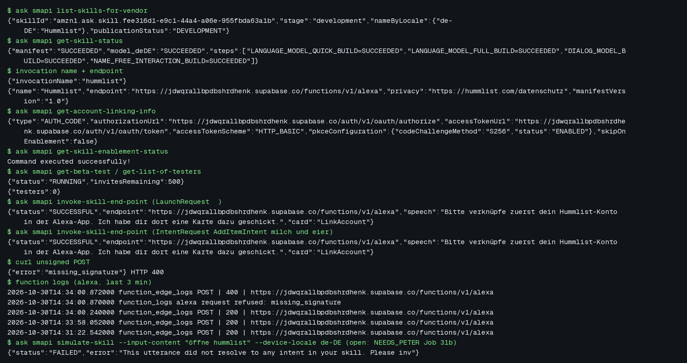

# Job 31b: deploy the Alexa skill "Hummlist" (de-DE, beta, no certification)

The skill from job 31 is live in the development stage of Peter's Amazon Developer account. A
beta test is running with no testers, so Hummlist Ops can invite people once Peter says who.
Nothing was submitted for certification or published.

| | |
| --- | --- |
| Skill id | `amzn1.ask.skill.fee316d1-e9c1-44a4-a06e-955fbda63a1b` (the only skill on the vendor) |
| Name, invocation | `Hummlist`, `hummlist`, de-DE |
| Endpoint | `https://jdwqrallbpdbshrdhenk.supabase.co/functions/v1/alexa` (function `alexa`, verify_jwt=false, migration `20261030140000_alexa.sql` applied) |
| Model build | de-DE SUCCEEDED (quick, full, dialog, name-free steps) |
| Account linking | Auth Code Grant to the Supabase OAuth server, HTTP Basic, PKCE S256, confidential client "Amazon Alexa" with the pitangui/layla/FE redirect URLs for the vendor; not skippable |
| Supabase secret | `ALEXA_SKILL_ID` = the skill id (also in the ops env file) |
| Development testing | enabled |
| Beta test | RUNNING, 0 testers, 500 invites left; no invites sent |
| Certification | not submitted |

Secrets (LWA tokens, the OAuth client secret) stay in the ops secrets directory (mode 600) and
in Amazon's and Supabase's stores. None are in the repo, the board or this note.

## Repo change

`ask deploy --target skill-metadata` uploads only what is inside `manifest`. `skill.json` had
`manifestVersion` at the top level, so the deploy dropped it from the live manifest. It now sits
inside `manifest`, live and in the repo. `skill_package_test.ts` fails on the old layout (type
check) and passes on the new one. docs/ALEXA.md "Deploy" now records the deployed state, the
`ask-states.json` step that stops a redeploy from creating a second skill, and the smoke test.

## Smoke test

Text: [alexa-deploy-smoke.txt](../screenshots/31b/alexa-deploy-smoke.txt).

- `invoke-skill-end-point`: Amazon signs a de-DE LaunchRequest and an AddItemIntent ("milch und
  eier") and sends them to the function. Both answer "Bitte verknüpfe zuerst dein
  Hummlist-Konto in der Alexa-App. …" with a LinkAccount card, and nothing is added. The
  function logs every failed check as "alexa request refused: <reason>" with a 400. These came
  back 200 with no such line, so the signature, chain, timestamp and skill-id checks passed. An
  unsigned POST gets 400 `missing_signature`.
- The account-linking client: its stored secret gets past client authentication at the token
  endpoint (`invalid_grant` for a made-up code), and a wrong secret gets `invalid_credentials`.
- **Open:** `simulate-skill` and `ask dialog` ("öffne hummlist", de-DE) answer "This utterance
  did not resolve to any intent in your skill". Alexa considers `<LaunchRequest>` and never
  calls the endpoint. Ruled out: waiting about 15 minutes after the build, an explicit model
  rebuild, adding US to the countries, `skipOnEnablement`, restoring `manifestVersion` (each
  reverted except the last). Probably the developer's amazon.com account has no Alexa setup.
  That is a guess. Peter's check is in NEEDS_PETER "Job 31b".

## Not done (by design)

No testers, no invites, no certification, no publishing. Calls are in DECISIONS "Job 31b".
