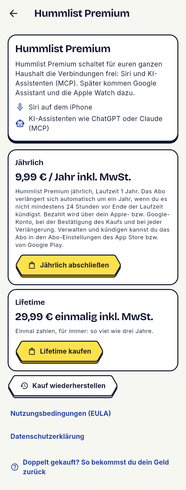
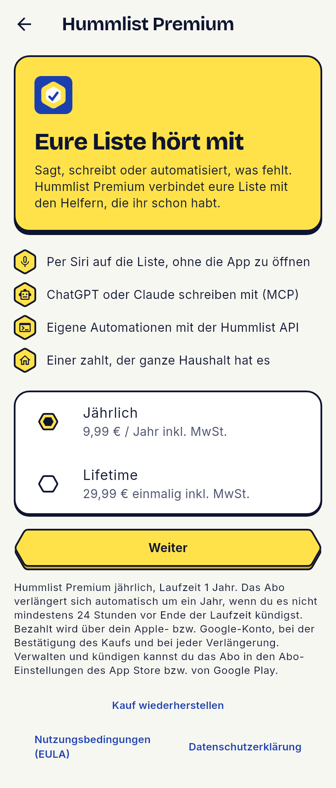
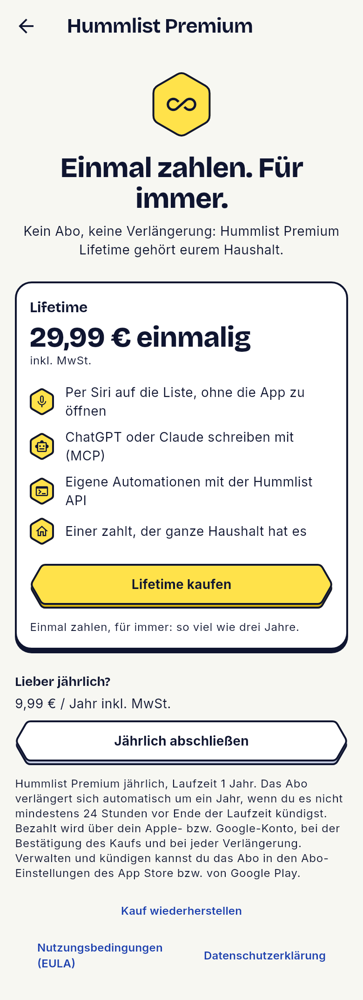
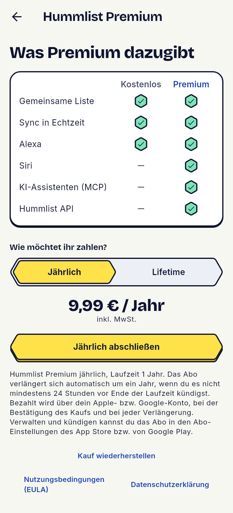
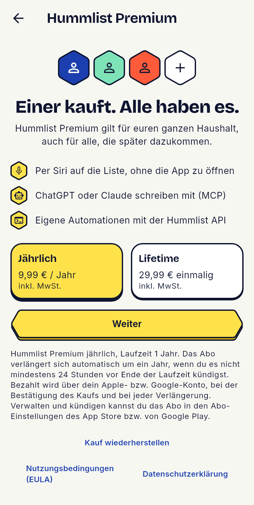
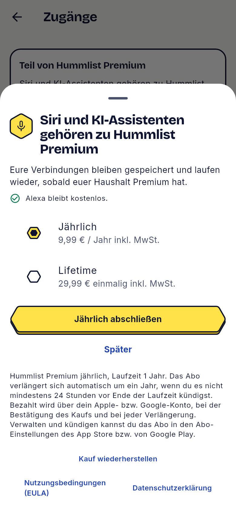

# Job 81: Paywall research and five prototypes

Not for merge. The PR exists so Vercel builds a preview of the review page. No flag, switch,
store product or price was changed.

## What was built

- **Research:** `docs/design/paywall-research.md`. RevenueCat as the main source (State of
  Subscription Apps 2025 and 2026, paywall tests, redesign case studies, placement, Lifetime
  pricing, Paywalls v2 components), plus Superwall, Adapty, AnyList, Bring!, Todoist, Things and
  Apple's and Google's subscription rules. Findings R1 to R16 and S1 to S8 with links, a patterns
  table, the DE/EU legal checklist L1 to L9 with questions Q1 to Q9 for Legal Review, and a
  mapping of each prototype to the findings it applies. Claims from search snippets are marked.
- **Five prototypes in the Flutter app:** `app/lib/purchases/paywall_prototypes.dart`. In a debug
  build, Mehr → Hummlist Premium has a "Paywall-Prototyp" switch on top: today's page or PW-P1 to
  PW-P5. With PW-P5 picked, the integration lock's "Hummlist Premium freischalten" opens it as a
  sheet over Zugänge. Release builds don't contain it.
  - PW-P1 Klassisch: honey hero with the outcome, four benefits, plans as radio rows, one button.
  - PW-P2 Einmal zahlen: Lifetime as the hero with its price as the big number, yearly below.
  - PW-P3 Vergleich: free next to Premium as a table, then a Jährlich/Lifetime toggle.
  - PW-P4 Haushalt: "Einer kauft. Alle haben es.", plans as two tiles side by side.
  - PW-P5 Aus der Sperre: the contextual sheet from the integration lock, with "Später".
  All show both plans at the configured launch prices (9,99 € a year, 29,99 € once; the store's
  own prices in the app once the page has read them), "inkl. MwSt." after a euro price, today's
  yearly disclosures, Restore, Terms and Privacy. Buttons buy nothing.
- **Review page:** `site/public/internal/paywall-prototypes.html` (noindex, preview only; the
  production build drops `internal/`), built by `node design/paywall-prototypes/build.mjs <shots>`.

## How to verify

```sh
cd app
flutter test test/purchases/paywall_prototypes_test.dart     # 9 tests
SCREENSHOT_DIR=/tmp/paywall81 flutter test --update-goldens \
  test/purchases/paywall_prototypes_screenshots_test.dart     # 21 shots
cd .. && PR=208 node design/paywall-prototypes/build.mjs /tmp/paywall81
cd site && node --test test/internal-paywall.test.mjs
```

`paywall_prototypes_test.dart` checks: the switch puts a prototype in the page's place; each
prototype shows both prices with "inkl. MwSt.", the yearly disclosures while yearly is picked,
Restore, Terms and Privacy, and its buy button calls no store; picking Lifetime swaps the
disclosures for its value line; a plan without a store price shows "€X,XX"; with PW-P5 picked
the lock's button opens the sheet and "Später" closes it. With VAT taken out of the code, 7 of the
9 fail.

## Screenshots

| Today | PW-P1 | PW-P2 | PW-P3 | PW-P4 | PW-P5 |
| --- | --- | --- | --- | --- | --- |
|  |  |  |  |  |  |

## Not done, on purpose

- No mascot (no approved asset; the design system rules a bee mascot out). DECISIONS "Job 81".
- No trial, monthly equivalent or social proof (none configured, Play policy, no real reviews).
- The feature map is unchanged: users see nothing new.
- Legal texts are unchanged; the open questions are in NEEDS_LEAD "Job 81".
